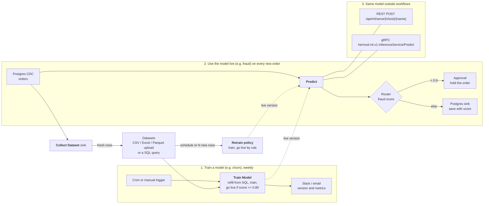

# Machine learning

Hermod trains machine-learning models on your data and calls them from
workflows and other applications. A model belongs to one vhost and is used
three ways: the **Predict** node in a workflow, the REST API, and gRPC.

A model is either **trained in Hermod**, on a dataset, by the `hermod-ml`
worker; or **served elsewhere** (mimir-server, KServe, Triton, MLServer,
MLflow) and registered by its address. Both are called the same way. A running workflow
keeps a dataset growing with the **Collect Dataset** sink, and a trained model
can retrain by itself on a schedule or once enough new rows have arrived.

It also prepares the features a model takes: the *Feature Engineering* nodes
scale, encode and bucketize fields, and compute rolling features and anomaly
scores per key (see [Feature engineering nodes](#feature-engineering-nodes)).



## In the console

Open **Machine Learning** in the sidebar (Editors and Administrators; the
page is at `/ml/models`). **Getting started**, at the top, walks through the
five steps from nothing to a model in use, and shows which are done for the
vhost you are on:

1. **Connect the training worker**: whether Hermod has a worker, whether the
   worker answers, and whether it can train the neural networks (the `-dl`
   image). **Set up the worker** opens a guide in three steps (see
   [Connect the worker](#connect-the-worker)): run the worker (one command to
   copy, for Docker, Docker Compose or Helm, with a **Generate token** button
   and a **Deep learning** switch), paste its address and token, then **Test
   connection** and **Save**. **Check again** asks Hermod again without
   reloading the page.
2. **Get your data**: done once the vhost has a dataset; **Go to Datasets**
   opens the **Data** tab ([Datasets](#datasets)).
3. **Check your data**: **Analyze** opens the analysis of the newest dataset
   ([Analyzing a dataset](#analyzing-a-dataset)), which also offers to train
   what the data suits. Done once a dataset was analyzed in this browser, or a
   model was trained.
4. **Train a model**: done once the vhost has a model trained here; **Start
   training** opens the Train dialog.
5. **Use it**: done once a trained model has a live version; it offers
   **Make it live** (the model's versions) or **Try your model** (one row).

Once all five are done the guide can be hidden; that is remembered per user in
the browser.

The page has one main button, **Add model**. It first asks how:

- **Train a new model from my data** opens the Train dialog
  ([Train a model](#train-a-model)).
- **Connect a model that's already running somewhere** opens a two-step form
  for a model on mimir-server, KServe, Triton, MLServer or MLflow
  ([Register a model served elsewhere](#register-a-model-served-elsewhere)):
  **Where it runs** (its name in Hermod, the kind of server, the server
  address, and the model's name and version there), then **What it takes**
  (its inputs and a description, with the access token secret, timeout and
  single input tensor folded under **Advanced options**). Every field has one
  line of help, and a mistake — no `http://`, a slash in a name, a token
  pasted where a secret name goes — is reported under the field, saying how to
  fix it, before anything is saved.

Below Getting started the page has tabs, each with one line saying what it
holds:

| Tab | What it holds |
|---|---|
| **Models** | The vhost's models: where each runs (trained in Hermod, or the server address), its status (**Version N live**, **Not live yet**, or **Connected** for one served elsewhere), whether apps can call it (a serving key exists), and the **AI assistants (MCP)** switch. Everything else is in the row's **…** menu: **Try it with one row**, **Versions and going live**, **Serving key for apps**, **Monitoring**, **Where it is scored**, **Train again**, **Retrain automatically**, **Edit connection** (a model served elsewhere) and **Delete model**. |
| **Data** | The [datasets](#datasets) models learn from. |
| **Training jobs** | Trainings and background predictions, with progress ([asynchronous jobs](#asynchronous-jobs)). |
| **Scripts** | [Custom training scripts](#custom-training-scripts); only when the server has them on. |
| **Limits** | The vhost's [quotas](#quotas). |

Until the worker is ready, **Train a new model from my data**, the Datasets
buttons, and a trained model's **Train again** and **Retrain automatically**
stay offered, disabled, with the reason beside them. Models served elsewhere
work without the worker.

## Train a model

Hermod trains the common models itself, with its **built-in engine**, and
needs nothing else for them. For TensorFlow, PyTorch, XGBoost and the rest it
uses **hermod-ml**, a Python worker beside Hermod (scikit-learn, XGBoost, and
in the `-dl` image PyTorch and Keras; every model is exported to ONNX and
served with ONNX Runtime; it never loads a pickle). Run it, then connect
Hermod to it. The two run together: connecting the worker adds what it
trains, and takes nothing away.

### The built-in engine

The built-in engine (pure Go, in the Hermod process) is always in force,
with or without a worker: Datasets, training, the Train Model node and the
Collect Dataset sink all work on it alone, and the worker status reports
`"source": "builtin"` while no worker is configured. It speaks the worker's
API in-process, so the console, the REST API and workflows do not change.

### Both engines at once

When a worker is connected, both engines serve, and which one does what
never depends on what is connected now:

- **Each version is served by the engine that trained it.** The built-in
  engine numbers its versions `b1`, `b2`, …; the worker numbers its own `1`,
  `2`, …. A version (and the versions list, with `"engine": "builtin"` or
  `"worker"`) says which, so the two never clash, and predictions,
  recommendations and in-process scoring of a model follow its live
  version to its engine.
- **Training goes where the algorithm is.** A built-in algorithm (`linear`,
  `random_forest`, `gradient_boosting`, `mlp`, `als`, `item_similarity`)
  trains in-process even with a worker connected. `auto` trains on the
  worker when one is connected (it compares more methods there) and
  in-process otherwise. Algorithms only the worker has, custom scripts and
  recommendation scenarios go to the worker.
- **Datasets stay in Hermod.** Rows, uploads and the Collect Dataset sink
  write to the built-in engine's store. A training on the worker is sent the
  dataset's rows first, once per change of the dataset. A dataset that only
  the worker has (one made there before) stays there: it is listed beside
  Hermod's with `"engine": "worker"`, rows sent to it go on to it, and it
  trains on the worker.
- **Disconnecting the worker** (or the worker going down) leaves every
  built-in model training and serving. Only a model whose live version the
  worker trained is refused, with `503` and *version N of model "…" needs the
  hermod-ml worker*; it serves again once the worker is back.

The worker status (`GET /api/ml/worker`) lists what either engine trains in
`algorithms`, and reports each engine under `engines`: `builtin`
(`available`, `algorithms`) and `worker` (`configured`, `ready`, `source`,
`error`, `algorithms`, `unavailable`). Getting started's first step is
**Optional: connect the hermod-ml worker for TensorFlow/PyTorch**, done once
a worker answers, and says so when one is set up but does not answer.

### Where the built-in engine keeps its data

Its datasets and model versions are kept in **Hermod's metadata database**
(SQLite, PostgreSQL or MongoDB, in the `ml_blobs` table or collection), not
on a server's disk. Any Hermod replica sharing that database trains on a
dataset another replica filled and serves a model another one trained, and
everything survives a restart onto a fresh disk or pod. Version numbers are
claimed in the database, so two replicas training one model at once get
`b1` and `b2`, never the same number; a deleted model's numbers are not
given again. Deleting a vhost deletes its blobs.

One blob is at most 256 MB (stored in 4 MB chunks): a dataset is kept as one
blob per append or upload, so the limit applies to one file or one batch of
rows (uploads are already capped at 200 MB), and a model's artifact is
compressed. Something larger is refused with `413` and says so.

| | Built-in engine | hermod-ml worker |
|---|---|---|
| `auto` (presets quick, balanced, best) | yes | yes |
| `linear` (ridge / logistic regression) | yes | yes |
| `random_forest`, `gradient_boosting` | yes | yes |
| `mlp` — **Neural network (built-in)** | yes | no |
| `extra_trees`, `hist_gradient_boosting`, `xgboost` | no | yes |
| `pytorch_mlp`, `keras_mlp` (TensorFlow) | no | `-dl` image |
| Custom training scripts | no | yes |
| Recommendations: `als`, `item_similarity`, `auto` | yes | yes |
| Recommendation scenarios | no | yes |
| Version export and import | no | yes |
| Scoring | in-process, Go | in-process ONNX, or the worker |

An algorithm the built-in engine does not have stays in the console's
Algorithm pickers, off, with **Needs the hermod-ml worker.**; asked for over
the API it answers `503` with the same reason, before any training starts.
The built-in `mlp` takes the same `params` as `pytorch_mlp` and `keras_mlp`
(`hidden_layers` default `[64, 32]`, `epochs` 200, `batch_size` 32,
`learning_rate` 0.001, `patience` 10; a tenth of the training rows decides
when to stop).

It is configured with environment variables; none is needed.

| Variable | Default | Meaning |
|---|---|---|
| `HERMOD_ML_BUILTIN` | on | `false` turns the engine off; training then needs a worker. |
| `HERMOD_ML_BUILTIN_DIR` | none | Used only when the metadata store cannot keep the engine's data (every supported one can); with more than one replica it must then be shared. |
| `HERMOD_ML_BUILTIN_MAX_TRAININGS` | `1` | Trainings at once; another one is refused with `429` until one ends. |
| `HERMOD_ML_BUILTIN_MAX_ROWS` | `1000000` | Rows a training reads; a larger dataset is sampled (with the seed) and the version says so. |
| `HERMOD_ML_BUILTIN_THREADS` | the CPUs Go may use | Goroutines a training uses; it also caps a network's `threads`. |
| `HERMOD_ML_TRAIN_TIMEOUT` | as for the worker | Bounds each training; it is cancelled when it runs out. |

**How it matches the worker.** It reads CSV, Excel, Parquet and JSON rows with the
worker's typing rules, prepares features the same way (median or most
frequent value for a gap, one-hot text, scaled numbers), holds back the same
share for testing, and reports the same metric names, baselines, warnings,
feature statistics and importance. A training repeats exactly for the same
seed. A recommender writes the same `model.rec` artifact the worker does, and
Hermod serves it the same way. A model's own artifact is a versioned,
size-limited JSON file, not ONNX, and is scored in-process.

**Where it differs.** These are deliberate:

- A version keeps the engine that trained it: to move a model to the other
  engine, train it again there (pick an algorithm that engine has).
- `best` tries more methods for longer, but does not search hyperparameters.
- Importance is measured on at most 10,000 test rows.
- A recommender's time column is read as numbers or ISO 8601 dates
  (`2026-01-31`, `2026-01-31 10:00`, `2026-01-31T10:00:00Z`, …).
- Random choices (the test rows, the people held back) follow the same rules
  as the worker's, but not numpy's random numbers, so the rows picked differ.

### Run the worker

One command, where Docker runs. From a checkout of Hermod:

```bash
./scripts/install-hermod-ml.sh                   # scikit-learn, XGBoost
./scripts/install-hermod-ml.sh --deep-learning   # adds PyTorch and TensorFlow (amd64 only)
```

It checks Docker, generates a random token, runs
`ghcr.io/gsoultan/hermod-ml` with `--restart unless-stopped` on port 8090 and a
`hermod-ml` volume, waits until the worker answers, and prints the address and
token to paste into Hermod. `--version X.Y.Z` runs a release (use Hermod's
own: the two are released together) instead of `latest`; `--network NAME`
also joins a Docker network, so a Hermod container on it reaches the worker as
`http://hermod-ml:8090`; `--token`, `--port` and `--name` set the rest. It
refuses rather than replaces a container that already exists, and the `-dl`
image on an arm64 Docker.

The same, by hand:

```bash
docker run -d --name hermod-ml --restart unless-stopped -p 8090:8090 -e HERMOD_ML_TOKEN=change-me \
  -v hermod-ml:/var/lib/hermod-ml ghcr.io/gsoultan/hermod-ml:latest
```

**Docker Compose.** [`deploy/compose/compose.yaml`](../deploy/compose/compose.yaml)
runs Hermod and the worker together with one token from a `.env` file
(`cp .env.example .env`, set `HERMOD_ML_TOKEN`, `docker compose up -d`). It
connects them through the environment, so the console shows the connection as
set by the server's environment.

With Helm: `--set mlWorker.enabled=true --set mlWorker.token=…` (or
`mlWorker.existingSecret`). The chart refuses to run the worker without a
token, and gives Hermod the worker's address and token itself.

### Connect the worker

On **Machine Learning**, **Getting started**, **Set up the worker**
(Administrators): paste the worker's address and token, press **Test
connection**, then **Save**. Saving takes effect at once, for training,
datasets, the Collect Dataset sink and the worker status; there is nothing to
restart. Another Hermod process on the same database (a `--mode=worker`
process with its own database connection) picks it up within 15 seconds.

The test calls the worker the way training will (its `/v2/health/ready`, then
`/v1/capabilities` with the token) and says what it found:

| Result | Means |
|---|---|
| Connected | The worker answered and took the token; also says whether deep learning (PyTorch, TensorFlow) is available. |
| The worker refused the token | It is there, but the token is not its `HERMOD_ML_TOKEN`. |
| Nothing answered at this address | Not running, wrong host or port, or not reachable from Hermod. Inside a container, `localhost` is that container: use the worker's container name on a network both share. |
| This is not hermod-ml | Something else answered there. |
| Not an address Hermod can call | Not an `http://` or `https://` URL with a host, or it holds a password, query or fragment. |

**Save** is offered once a test has run for the address and token shown
(**Save anyway** when the test failed). Leaving the token empty keeps the
saved one; an empty address disconnects the worker. Others see who to ask
instead of the form.

The token is stored in Hermod's settings, encrypted with the master key like a
connector's credentials, and rotated with them (`PUT /api/config/crypto`); it
is never sent back to the browser, which sees only whether one is set. The
worker is called with Hermod's data client, which reaches private addresses
(the worker runs beside Hermod), exactly as with the environment variables.

**The environment wins.** When `HERMOD_ML_WORKER_URL` is set, that worker is
used and the console shows it read-only, as set by the server's environment;
change it there and restart Hermod. The Helm chart and the compose example
connect this way.

| Setting | On | Meaning |
|---|---|---|
| `HERMOD_ML_WORKER_URL` | Hermod | Optional. The worker's address, e.g. `http://hermod-ml:8090`; when set it wins over the console. |
| `HERMOD_ML_WORKER_TOKEN` | Hermod | Sent as a bearer token; must equal the worker's `HERMOD_ML_TOKEN`. |
| `HERMOD_ML_TRAIN_TIMEOUT` | Hermod | How long one training may take, default `30m`. Applies to a worker connected either way. |
| `HERMOD_ML_TOKEN` | worker | Required token. Without it the worker is open: never run it so outside a private network. |
| `HERMOD_ML_DATA_DIR` | worker | Datasets and model versions, default `/var/lib/hermod-ml`. Keep it on a volume. |
| `HERMOD_ML_MAX_TRAININGS` | worker | Trainings at once, default 1; another gets "busy". |
| `HERMOD_ML_TRAIN_THREADS` | worker | The most CPU threads a deep-learning training uses, default 0: every CPU but one. |
| `HERMOD_ML_SERVE_THREADS` | worker | Each loaded model's ONNX Runtime intra-op threads, default 1; 0 for ONNX Runtime's own default (one per core). |

The API behind the guide, for Administrators:

| Route | Does |
|---|---|
| `GET /api/ml/worker/connection` | `{"source": "environment" \| "saved" \| "none", "url", "token_set", "editable"}`. Never the token. |
| `PUT /api/ml/worker/connection` | `{"url", "token"}` saves and connects at once; no `token` keeps the saved one; `"url": ""` disconnects. 409 while the environment sets the worker, 400 for an address Hermod cannot call. Audited, without the token. |
| `POST /api/ml/worker/connection/test` | `{"url", "token"}` (no `token` tests with the saved one). Always 200: `{"result": "ok" \| "unauthorized" \| "unreachable" \| "not_a_worker" \| "bad_address" \| "error", "message", "deep_learning", "frameworks"}`. |

`GET /api/ml/worker`, for any signed-in user, also says the worker's `source`.

### Image variants

| Image | Tags | Adds | Platforms |
|---|---|---|---|
| `hermod-ml` | `X.Y.Z`, `X.Y`, `latest` | scikit-learn, XGBoost | linux/amd64, linux/arm64 |
| `hermod-ml` deep learning | `X.Y.Z-dl`, `X.Y-dl`, `latest-dl` | CPU-only PyTorch 2.9 and TensorFlow 2.20 with Keras 3 (`pytorch_mlp`, `keras_mlp`) | linux/amd64 |

The `-dl` image is the same worker with `requirements-dl.txt` installed
(`docker build --build-arg HERMOD_ML_EXTRAS=dl ml/worker`). It is about 2 GB
larger (TensorFlow alone installs 1.2 GB) and is amd64 only: `tensorflow-cpu`
publishes no aarch64 wheels.
With Helm, choose it with `--set mlWorker.image.variant=dl` (the chart appends
`-dl` to its default tag; an explicit `mlWorker.image.tag` is used as given).

The slim image refuses `pytorch_mlp` and `keras_mlp` with a 400 that says they
are "not available in this image". The worker's `GET /v1/capabilities` lists
what it can train; Hermod passes the list on (`GET /api/ml/worker`), and the
Train dialog, the retrain policy and the Train Model node offer those
algorithms. On a slim worker the two networks stay in the Algorithm list,
disabled, with the image they need ("Keras MLP — TensorFlow" is the Keras one).

**Resources.** The libraries load on the first deep-learning training and stay
loaded: PyTorch, TensorFlow and tf2onnx add about 650 MiB to the worker
(measured 274 MiB → 910 MiB resident, before any data). Raise
`mlWorker.resources.limits.memory` by at least 1Gi over what your datasets
need, and request a core or more of CPU: a network trains on CPU, for up to
`epochs` passes over the data. Training holds a worker slot
(`HERMOD_ML_MAX_TRAININGS`) until it finishes, and `HERMOD_ML_TRAIN_TIMEOUT`
still bounds it on Hermod's side.

### Datasets

On the **Machine Learning** page, on the **Data** tab:

- **Upload a file**: CSV, Excel `.xlsx` (first sheet, header row) or Parquet,
  up to 200 MB. A Parquet file must have plain columns: a list, map or nested
  group is refused with its column's name (flatten it first). Its types are
  kept: whole and decimal numbers become numbers, booleans yes/no, dates
  `2026-10-15`, timestamps ISO-8601 text (with `+00:00` when the file says
  UTC), and dictionary-encoded text plain text. The size limit and the
  vhost's quotas apply as to the other formats.
- **From a database**: a `SELECT` on one of the vhost's database sources
  (Postgres, MySQL/MariaDB, SQL Server, Oracle, SQLite, ClickHouse, DB2), run
  read-only with the source's own credentials, at most 1,000,000 rows unless you
  set another cap. Millions of rows can be read: they are sent 1,000 at a time.
  A query that returns more than the cap (or the vhost's **Rows per dataset**
  quota) is stopped with an error and the dataset keeps the rows read so far.
  On the built-in engine, a prediction model learns from at most
  `HERMOD_ML_BUILTIN_MAX_ROWS` rows (a larger dataset is sampled); see
  [What data each model needs](#what-data-each-model-needs) for the limits and
  for how to shrink a big table in the query.

Filling a dataset again replaces its rows. Both forms say, for the kind of
model you pick, which columns the file or query should hold, with a CSV
template or an example query.

Each dataset has an **Analyze** button; the eye button opens the same
dialog on its first rows, and the clock button refreshes it on a schedule.
An uploaded file is analyzed as soon as it is in, and **From a database**
offers **Check this data** once the rows are read.

#### Send to mimir-server

The paper-plane button on a dataset copies it to a
[mimir-server](https://github.com/gsoultan/mimir-server), where a model can
be trained on it and then connected back here (see [Register a model served
elsewhere](#register-a-model-served-elsewhere)). The dialog takes the server's
address and the name of the vhost secret holding a `mimir_...` API key (the
address and secret of a mimir model already connected are offered), the name
the dataset gets on the server (the Hermod name when empty) and the column a
model will learn to predict (the server takes the last column when empty).
The rows are read from the ML worker and sent as CSV; the key never passes
through the browser. The answer shows how many rows arrived and the server's
verdict on the data (good, warn or bad).

Behind it: `POST /api/vhosts/{vhost}/ml/datasets/{name}/mimir` (Editor) with
`{"url", "token_secret", "name", "target"}`, answering the server's dataset
(`id`, `name`, `rows`, `target`, `columns`, `verdict`). A dataset is at most
200 MB as parquet; a nested column cannot be sent.

mimir has no "append" for a dataset, so each send makes a new dataset there:
send again after the rows change here. For data the server should keep fresh
on its own, make the dataset on the server from a database query instead and
let its refresh run.

### Analyzing a dataset

**Analyze** checks a dataset before you train on it, in four tabs:

- **Overview**: the size and kinds of columns in a sentence or two; **What
  this data is good for**, the kinds of model the columns suit (predict a
  category, predict a number, recommendations), each with why, whether it is
  ready, and **Train this model**, which opens the Train dialog with the
  dataset, the column to predict or the recommendation scenario filled in;
  and **Things to check**, worst first, each with **How to fix**.
- **Columns**: per column, its kind (number, category, date, yes/no, free
  text, ID, empty), how many cells are empty and how many values differ; for
  a number its range, median, average, middle half and a histogram; for a
  category its most common values and their shares; for a date its range and
  rows per month (per year past 36 months).
- **Related columns**: the number columns that move together most
  (correlation 0.3 or more, the ten strongest).
- **First rows**: the rows the server keeps for a preview.

The checks:

Each check says how serious it is: **Fix before training**, **Worth fixing**
or **Good to know**.

| Check | When | Seriousness |
|---|---|---|
| Few rows | under 10 rows (training refuses), or under 100 | fix before training / worth fixing |
| Empty column | no row has a value | worth fixing |
| Mostly empty | 60% or more empty | worth fixing |
| Constant | one value in every row | good to know |
| Duplicate rows | the same row more than once | worth fixing above 1% of rows, else good to know |
| Looks like an ID | a different value in 95% or more of the rows | good to know |
| Many different texts | free text, or a category with very many values | good to know |
| Unusual values | numbers far outside the rest (3 × the middle half past it) | good to know |
| Skewed | a long tail of large or small values | good to know |
| Imbalanced | one value in 90% or more of the rows | good to know |
| Future dates | dates after today | worth fixing |
| Near copies | two number columns that move together almost exactly | good to know |

The thresholds are the ones training's own data check uses, so the analysis
and the Train dialog agree.

**Big datasets.** The analysis reads at most 50,000 rows (and 1,000,000
cells), spread evenly over the whole dataset; above that the numbers are
close estimates and the dialog says so. Text longer than 200 characters is
cut for the analysis. The rows are read on the engine that holds the dataset,
built-in or worker, and measured by Hermod; a hermod-ml worker older than
analysis answers `501` with "update it".

**API.** `GET /api/vhosts/{vhost}/ml/datasets/{name}/profile` returns the
analysis as JSON (Editors and Administrators of the vhost). The engines
serve the sample it reads at `GET /v1/datasets/{vhost}/{name}/sample?rows=N`.

### Training

**Train a model** (**Add model** → **Train a new model from my data**) asks for a dataset, the column to predict, and optionally the
columns to learn from (empty means all the others). The task (classify, or
predict a number) is chosen from the target unless you pick it. The algorithm
is `auto` unless you pick one: Auto tries several and keeps the best (see
**Auto and presets** below).

| Algorithm | Library | Notes |
|---|---|---|
| `auto` | | Tries several of the algorithms below on the training rows and keeps the best. |
| `random_forest` | scikit-learn | 100 trees. |
| `extra_trees` | scikit-learn | 100 extremely randomised trees: like a random forest, with random split points; often as good and faster. |
| `hist_gradient_boosting` | scikit-learn | Histogram gradient boosting: fast on large tables. At most 20 rows per leaf, fewer on a table under 200 rows. |
| `gradient_boosting` | scikit-learn | |
| `linear` | scikit-learn | Logistic regression to classify, least squares for numbers; numbers are standardised. |
| `xgboost` | XGBoost | 200 trees, depth 6, `hist`. |
| `pytorch_mlp` | PyTorch | Multilayer perceptron; `-dl` image only. |
| `keras_mlp` | TensorFlow/Keras | The same network in Keras; `-dl` image only. |

Every built-in algorithm exports to ONNX, and the worker refuses a version
whose exported graph does not give the trained model's labels and
probabilities (or values) on the held-out rows. `extra_trees` and
`hist_gradient_boosting` export as tree ensembles, so in-process scoring serves
them too.

Every algorithm reads the same inputs: numbers as they are (missing ones get
the training median), text one-hot encoded, and for `linear` and the two
networks, numbers standardised. The exported model takes one tensor per
feature and answers like any other, so a model can be retrained with another
algorithm without touching the workflows that call it.

The two networks (ReLU hidden layers, softmax or a linear output, Adam) hold a
tenth of the training rows back to stop early, and keep the weights that did
best on them. Under **Advanced** in the Train dialog, or the node's settings,
you can change:

| Parameter | Default | Range |
|---|---|---|
| Hidden layers | `64, 32` | 1 to 5 layers of 1 to 1024 units |
| Epochs | 200 | 1 to 1000 |
| Batch size | 32 | 1 to 4096 |
| Learning rate | 0.001 | above 0, at most 1 |
| Patience | 10 | epochs without a better validation loss before stopping, 1 to 1000 |
| Weights (`precision`) | `auto` | `auto`, `float32` or `int8`: see [Deep learning on little CPU, memory and disk](#deep-learning-on-little-cpu-memory-and-disk) |
| Training threads (`threads`) | every CPU but one | 0 to 256; 0 is the default |

The seed is fixed (42 unless the API request sets `seed`), so the same data
and settings train the same model. Each version records the parameters it used
as `params`. Numbers are standardised before training and the target too for
regression; the exported graph does both, so predictions come back in the
target's units.

A fifth of the rows are held back to score the model:

- classification: `accuracy`, `balanced_accuracy` (the mean of each class's
  recall), `f1` (macro), `roc_auc` (two classes); `score` is accuracy
- numbers: `rmse`, `mae`, `r2`; `score` is R²

**Auto and presets.** With `algorithm: "auto"`, the worker scores candidate
algorithms by cross-validation on the training rows only, and trains the best
on all of them. The held-out rows are never used to choose, so the version's
metrics are not flattered by the choice. `preset` (auto only; any other
algorithm with a preset is a 400, and so is a recommendation model, whose Auto
always tries both of its methods) says how hard it tries:

| Preset | Candidates | Scored on | Time budget |
|---|---|---|---|
| `quick` | `hist_gradient_boosting`, `linear` | One validation split (a quarter of the training rows) | 30 s |
| `balanced` (default) | `hist_gradient_boosting`, `random_forest`, `linear`, `xgboost` (`extra_trees` when XGBoost is missing) | 3-fold cross-validation | 120 s |
| `best` | All of the above and `extra_trees`, plus the MLP (`pytorch_mlp`, else `keras_mlp`) in the `-dl` image | 5-fold cross-validation, and two alternative settings per algorithm | 600 s |

Once the budget runs out, no further candidate or fold starts; the first
candidate is always scored, and the version's warnings name what was skipped.
A candidate that fails on the data is skipped with a warning, not the whole
training. A classifier is judged by balanced accuracy and a regression by R².

**Lopsided targets.** When the rarest class of a classification target has at
most a quarter as many rows as the most common one, every algorithm is
trained with balanced class weights (per-row weights for `xgboost` and
`gradient_boosting`), so the rare classes count. With balanced accuracy as
Auto's yardstick, a model that only ever predicts the common class scores 0.5
and cannot win.

**What a version records.** Besides `metrics`, every built-in training stores:

| Field | What |
|---|---|
| `baseline` | The same metric keys, scored by a model that always answers the most common class (classification) or the mean (regression). A model is only useful by its margin over this. |
| `importance` | `[{feature, weight}]`: permutation importance on the held-out rows (each feature shuffled five times; the drop in balanced accuracy or R² is its weight). Negative weights count as 0, weights are normalised to sum to 1, and the top 20 are kept, heaviest first. |
| `warnings` | Notes on the data in plain words: few rows, a lopsided target, ID-like, constant, mostly empty or suspected leaking columns, and anything Auto skipped. |
| `preset`, `leaderboard` | Auto only: the preset, and `[{algorithm, score, metric, folds, seconds, chosen}]` for every candidate scored, best first. |

**Pre-flight check.** `POST /api/vhosts/{vhost}/ml/train-check` (Editor) takes
the same body as a training (`name`, `go_live` and `params` are ignored),
trains nothing, and answers in a moment: the detected `task`, the target in
words (`target_kind`: `yes_no`, `category` or `number`, with `classes` for a
classification), `rows` and `usable_rows` (rows with a target), a `role` per
column with a `note`, `warnings` (`code`, `message`, `column`), and `ok`, which
is false only when a training would be refused (fewer than 10 usable rows, or
a target with one value). Column roles:

| Role | Meaning |
|---|---|
| `target` | The column to predict. |
| `mostly_empty` | More than 60% of its values are missing. |
| `constant` | At most one distinct value. |
| `id_like` | A text or whole-number column with a distinct value on at least 95% of the rows. |
| `leak_suspect` | It gives the answer away: for a classification, a one-column decision tree (or, for text, each value's most common class) fitted on half of a sample of at most 5,000 rows predicts the other half with a balanced accuracy of at least 0.98; for a regression, an absolute correlation of at least 0.98 with the target. Checked only with 20 or more rows. |
| `use` | None of the above. |

Warning codes: `few_rows` (under 100 usable rows, or under the minimum),
`imbalanced`, `many_classes` (more than 20 classes), and the column roles
above. The worker runs the check at `POST /v1/train-check/{vhost}`; Hermod
always asks the main worker, which holds the datasets, whatever the spec's
device or algorithm, and maps its errors as for a training. The check is for a
column to predict: a body with `task: "recommendation"` is a 400 that says to
train the recommender directly.

Every training makes a new, immutable version. Whether it goes live is your
rule: **only when I put it live**, **always**, or **if it scores at least** a
minimum on a metric. A version that is not put live is kept; **Versions and going live** on
the model lists them all and puts any one live, which is also how you roll back.

### Deep learning on little CPU, memory and disk

Both engines train their networks in float32 and, by default, keep int8
weights when those score as well, so a network costs little to train, store
and serve.

**Which engine.** For tabular data of up to a million rows (the built-in
engine's `HERMOD_ML_BUILTIN_MAX_ROWS`), the built-in `mlp` is the cheapest:
no worker, no PyTorch (the `-dl` image adds about 2 GB and 650 MiB resident),
scored in-process in microseconds. Take `pytorch_mlp` or `keras_mlp` on the
worker for a GPU pool, or when you already run the `-dl` image.

**What happens.**

- **float32.** The built-in network trains and scores in float32, from a
  float32 copy of the rows (never a float64 one). The worker's networks
  always trained in float32.
- **int8 weights.** After training, the weights are quantised to int8, one
  scale per layer (the built-in engine; the worker uses ONNX Runtime's
  dynamic quantisation of the graph's matrix multiplications). The int8
  network is scored against the float32 one on the tenth of the training
  rows held back to stop early: a classifier may lose at most 0.5 points of
  accuracy, a regression may add at most 1% to its RMSE. `precision: auto`
  (the default) keeps int8 within that tolerance and float32 otherwise;
  `float32` never quantises; `int8` keeps int8 whatever it scores. The
  version's metrics are those of the network it keeps.
- **Threads.** A training uses at most `threads` CPU threads (default: every
  CPU but one), capped by `HERMOD_ML_BUILTIN_THREADS` on the built-in engine
  and `HERMOD_ML_TRAIN_THREADS` on the worker. The built-in engine splits a
  batch over goroutines only when it is big enough to be worth it (about a
  million multiply-adds a goroutine: from about 128 rows on the default
  network), so a small batch does not spend CPU on coordination; the network
  trained is the same for any number of threads. The worker sets PyTorch's
  threads for the training (`torch.set_num_threads`); Keras keeps
  TensorFlow's own.
- **Serving threads.** The worker gives each loaded model one ONNX Runtime
  thread (`HERMOD_ML_SERVE_THREADS`, 0 for ONNX Runtime's default of one per
  core): tabular graphs are too small to gain from more, and the default
  spent 2.5 times the CPU per row for the same latency (below).
- **Text columns.** A network one-hot encodes the 100 most frequent values
  of a text column; any other value encodes as all zeros, like a value never
  seen. The built-in engine always did; the worker now does for its
  networks, where an ID-like column used to make the input thousands of
  columns wide. The built-in network looks up a category's weights instead
  of multiplying a one-hot vector, which is what an embedding layer
  computes; neither engine trains separate, smaller entity embeddings.
- **The graph.** The worker saves a network's ONNX graph after ONNX
  Runtime's basic optimisations (standard operators only).

Each network's version records how it is kept, beside `params`:

```json
"efficiency": {"requested": "auto", "precision": "int8", "threads": 3,
               "metric": "accuracy", "float32": 0.8315, "int8": 0.8296, "tolerance": 0.005}
```

`float32` and `int8` are the two scores on the held-back rows; they are
absent when `float32` was asked for. Versions trained before this have no
`efficiency`, and score exactly as they did: a built-in network saved before
keeps its float64 weights and float64 scoring.

**Cheaper still.** A larger `batch_size` (256 or more) takes fewer optimiser
steps per epoch and lets the built-in engine use its threads; it may need a
higher `learning_rate` to reach the same score. Lower `patience` stops
sooner.

**Measured.** `go run ./ml/bench/gomlp` trains the built-in network on a
generated table of 40 columns (30 numbers with 5% missing, 8 text columns of
3 to 10 values, 2 ID-like text columns of 500 and 2,000 values) and a yes/no
target, 80% to train and 20% to test, at most 30 epochs (10 for a million
rows), default settings otherwise; one run per configuration, the main
branch's code against this change's, back to back. The machine was a shared
4-CPU VM (Intel Xeon, 2.1 GHz) with a load average of about 9 from other work,
so times carry noise of several percent; memory, sizes and quality do not.

| Built-in `mlp` | 200,000 rows, before | after | 1,000,000 rows, before | after |
|---|---|---|---|---|
| Training CPU | 38.8 s | 29.7 s | 161.2 s | 113.9 s |
| Training wall time | 40.3 s | 30.6 s | 168.1 s | 116.3 s |
| Peak resident memory while training (data alone) | 171 MB (92 MB) | 157 MB (92 MB) | 814 MB (442 MB) | 755 MB (442 MB) |
| Allocated while training | 114 MB | 70 MB | 527 MB | 304 MB |
| Saved model | 186,084 B | 21,761 B | 183,459 B | 22,171 B |
| Scoring one row, p50 / p95 | 8.7 / 16.9 µs | 5.0 / 6.6 µs | 6.9 / 11.9 µs | 4.7 / 8.0 µs |
| Scoring a batch | 110,866 rows/s | 249,651 rows/s | 157,808 rows/s | 233,455 rows/s |
| Test accuracy / ROC AUC | 0.8293 / 0.9143 | 0.8294 / 0.9146 | 0.8362 / 0.9202 | 0.8360 / 0.9202 |
| Precision kept | float64 | int8 | float64 | int8 |

Always answering the most common class scores 0.5555 (0.556 at a million
rows). Both trainings stopped early after 13 epochs at 200,000 rows. With
batches of 32 the after column trained on one goroutine (too little work per
batch to split); with batches of 512 at 200,000 rows and 8 epochs, three
threads took 9.9 s against 13.4 s on one in one run and 10.7 s against
12.5 s in another, for the same CPU time and the same model.

`python ml/bench/worker_deep.py serve` measures the worker's side that needs
no PyTorch: the graph of a network of the default shape (64, 32; random
weights) on the same table, behind the worker's own preprocessing, scored
with ONNX Runtime 1.20 on the same machine.

| Worker graph | One-hot of every value (before) | Top 100 values (after) |
|---|---|---|
| Network inputs | 2,582 | 282 |
| Graph, float32 / int8 | 689,498 / 190,215 B | 86,144 / 28,459 B |
| One row, 1 thread: p50 latency, CPU | 75 µs, 92 µs | 74 µs, 85 µs |
| One row, ONNX Runtime's default threads: p50 latency, CPU | 71 µs, 232 µs | 61 µs, 105 µs |
| A batch of 20,000, 1 thread, float32 | 50,595 rows/s | 324,125 rows/s |
| Largest change in a probability, int8 against float32 | 0.0002 | 0.0007 |

int8 shrinks the worker's graph about threefold but does not make ONNX
Runtime score these small graphs faster (the int8 batch rate was 38,749 and
315,578 rows/s); its gain there is storage. The matrix the worker trains on
is 2,582 against 282 columns wide: at 160,000 training rows, 3.3 GB against
0.36 GB as scikit-learn's float64 output (computed from the widths, not
measured). Training `pytorch_mlp` itself was not measured here: this machine
cannot install PyTorch (its package index is out of reach, and the PyPI
wheel needs more disk than was free). `python ml/bench/worker_deep.py train`
measures it on a `-dl` worker.

### Guided training

**Train a model** walks through five steps, in plain words, so no machine
learning knowledge is needed:

1. **Your data.** Name the model, pick a dataset, and check its first rows.
2. **What to do.** "What do you want to do?": **Predict a column** (the
   default) or **Recommend items to people**, which asks four questions in its
   place (see [Recommendations](#recommendations)). To predict a column, pick
   it. Hermod runs a pre-flight check
   (`POST /api/vhosts/{vhost}/ml/train-check`, the train body, nothing trained)
   and says what the column is: a yes/no question, a category, or a number.
   Columns that would spoil the model are unticked for you: ID-like columns,
   constant ones, mostly empty ones, and any that give the answer away. Each
   warning has a one-click fix, such as putting a column back or choosing
   another dataset. When the check says training would be refused, the dialog
   stops here and says why. A checklist of the dataset against
   [what the model needs](#what-data-each-model-needs) (columns, rows with an
   answer, different answers) sits under the target, and **What data do I
   need?** under each card opens that guide.
3. **How careful.** **Quick** (about a minute), **Balanced** (recommended, a
   few minutes) or **Best quality** (10 minutes or more) is sent as `preset`
   and sets how much Auto tries. **Advanced** holds the task, algorithm, device
   and neural-network settings; picking an algorithm there trains only that
   one, and no preset is sent. A recommender has no quality to pick: Hermod
   tries both of its methods and keeps the better one, and **Advanced** holds
   the method.
4. **Train.** One button; leave the window open while it runs.
5. **Result.** A headline such as "Right 87 of 100 times on rows it never
   saw" (classification, from `accuracy`) or "Typically off by 12.4" (numbers,
   from `mae`). A **good / fair / weak** badge says how much of the gap between
   the version's `baseline` (a model that always guesses the most common answer
   or the average) and a perfect score it closes: at least half is good, at
   least a fifth fair. Then **What mattered most** (`importance`), **What Auto
   tried** (`leaderboard`) and the next steps: **Try it** with a row of the
   dataset, **Make it live**, **Copy API call**, or use it from a Predict node.
   The raw metrics are under **Details**. A recommender's result reads
   differently; see [How good is it](#how-good-is-it).

Training a model again opens on step 2 with the last version's dataset, target
and columns; a recommender's opens on the recommend path with its columns
filled in. Every one of these fields is optional: against a server without
the check or the new result fields, the dialog learns from every other column
and shows the headline and metrics as before. The Train Model node has the same
quality picker, saved as `preset`, with the expert fields under **Advanced**.

### Train Model node

*Machine Learning → Train Model* does the same from a workflow: each message
that reaches it trains a new version, and the message carries the result under
`training` (version, metrics, `live`, and why). Optionally it first refills the
dataset from a database source with a query, so a weekly cron workflow keeps
the model fresh. Put it in a workflow that runs on a schedule or on demand,
not one that sees every change to a table. Its `preset` setting (`quick`,
`balanced` or `best`) applies when the algorithm is auto, and is ignored for
any other.

A trained model is called like any other: the Predict node sends a record's
fields, one per feature, and gets back `label` and `probability` for a
classifier, or `value` for a number.

### Collect Dataset sink

*ML Datasets → Collect Dataset* is a sink: every record it receives becomes a
row of a dataset of the workflow's vhost, appended on the worker. It never
replaces the dataset, and it writes only to its own vhost's datasets: a sink of
one vhost refuses records of a workflow in another.

| Setting | Meaning |
|---|---|
| `dataset` | Required. The dataset's name; a new name starts a new dataset. |
| `column_mappings` | Which fields become which columns, as the database sinks map them. Empty means the whole record, nested fields flattened to `parent_child` columns. |
| `mask_fields`, `mask_type` | Columns masked before the row leaves Hermod: `all` (`****`, the default), `partial`, `email` or `pii`, as the Mask node applies them. |
| `max_rows` | The dataset stops growing here, default 1,000,000. Later records are skipped and a warning is logged once. |

Rows go to the worker in batches, 500 at a time or every 5 seconds unless the
sink's reliability settings say otherwise; each append is one part file on the
worker. A failed append fails the batch, which is retried and then
dead-lettered like any other sink's, and a stopping workflow flushes what it
holds. Deleted records are not added.

### Retraining

**Retrain automatically** (in the model's **…** menu) on a model trained in Hermod makes it train again by
itself:

- on a **schedule**, a cron expression such as `0 3 * * *` or `@daily`; and/or
- after **N new rows**: once its dataset holds N rows more than when the model
  last trained, by any means.

The policy holds the training (dataset, column to predict, features, task,
algorithm) and the go-live rule, as **Train a model** does. Hermod checks every
minute. A model is claimed in the database before it trains, so with several
Hermod servers each retraining runs once, and never while another training of
the same model, manual or not, is running (a manual training then gets 409).
The Machine Learning page shows the policy and the last retraining: the version it made
and whether it went live, or its error. A failed retraining is tried again
after 15 minutes; a worker that is busy is asked again on the next check.

Over the API: `PUT /api/vhosts/{vhost}/ml/models/{name}/retrain` with
`{"schedule","new_rows","spec":{"dataset","target","features","task","algorithm"},"go_live":{"mode","metric","min"}}`
sets it, `DELETE` on the same path clears it. The model's `retrain` and
`retrain_status` fields show both.

The spec is a whole training spec, so it can also name a `device` and a custom
script (`"algorithm": "custom:<name>"`): a retraining runs where a training by
hand would, on the GPU or custom-script pool, and is refused the same way when
that pool or custom scripts are off. A custom script retrains with its latest
version at the time. An unknown device, or `gpu` with a custom script, is
refused when the policy is saved.

### In-process scoring

By default every prediction of a model trained in Hermod is an HTTP call to
the worker. **Where it is scored**, in a trained model's **…** menu, can set it to
**in-process** instead: Hermod fetches the live version's ONNX graph from the
worker once and scores it itself, in pure Go (`pkg/ml/onnxscore`), with no
round trip.

It covers what the worker trains — linear, random forest, extra trees,
gradient boosting, histogram gradient boosting and XGBoost models, for
classification and regression. The graph may use only
these operators:

| Domain | Operators |
|---|---|
| `ai.onnx.ml` (opset 1–3) | `LinearClassifier`, `LinearRegressor`, `TreeEnsembleClassifier`, `TreeEnsembleRegressor`, `Scaler`, `Normalizer`, `OneHotEncoder`, `FeatureVectorizer` |
| `ai.onnx` (opset 1–23) | `Concat`, `Gather`, `Reshape`, `Cast`, `Identity`, `Softmax`, `ArgMax` |

The worker's exports use `Concat`, `Gather`, `Reshape` and `OneHotEncoder` to
lay out the features; `linear` adds `Scaler` and `LinearClassifier` (then
`Normalizer` for more than two classes) or `LinearRegressor`; the tree models
use `TreeEnsembleClassifier` or `TreeEnsembleRegressor`.

Nothing is guessed. A graph with any other operator, attribute or tensor
layout is refused when it loads, and the model keeps being scored by the
worker; so is a call whose rows hold a value the worker would read in a way
the scorer does not reproduce exactly (a feature missing from every row, or a
number given as text it would not parse the same). The status says which
version is scored in-process and its operators, or why it falls back. A new
live version is loaded on the next call. An in-process prediction is logged
and counted for drift exactly as one the worker scores (see
[Monitoring](#monitoring)). Each version's results match
onnxruntime to within 1e-5: the parity fixtures in
`pkg/ml/onnxscore/testdata` are produced by onnxruntime and regenerated with
`python -I pkg/ml/onnxscore/testdata/gen_fixtures.py` in the worker's
environment.

Measured with `go test -bench WorkerVsInProcess ./pkg/ml/onnxscore/` (a
worker on the same machine, reached over loopback, scoring the same version
both ways; 4-core Xeon at 2.1 GHz):

| Model | 1 row: worker | 1 row: in-process | 100 rows: worker | 100 rows: in-process |
|---|---|---|---|---|
| linear, binary | 1.85 ms | 5.6 µs | 2.47 ms | 82 µs |
| random forest, binary | 1.68 ms | 6.3 µs | 3.90 ms | 392 µs |
| gradient boosting, 3 classes | 2.36 ms | 12.3 µs | 4.59 ms | 685 µs |
| XGBoost, regression | 1.71 ms | 8.1 µs | 3.22 ms | 577 µs |

A worker over a real network adds its round trip to the worker column. Set
`HERMOD_ML_BENCH_WORKER_URL` (and `HERMOD_ML_BENCH_WORKER_TOKEN`) to run it;
`-bench InProcess` alone needs no worker.

Over the API: `GET /api/vhosts/{vhost}/ml/models/{name}/scoring` returns
`{"scoring","in_process","version","ops","reason"}`, and `PUT` on the same
path with `{"scoring":"worker"}` or `{"scoring":"in_process"}` (Editor) sets
it and answers with the new status. The model's `scoring` field holds the
setting. Only a model trained in Hermod can be scored in-process. The graph is
read from the worker's
`GET /v1/models/{vhost}/{name}/versions/{version}/model.onnx`.

## What data each model needs

Every card in **Train a model** has a **What data do I need?** link that opens
this guide for that kind of model, and the dialog keeps a checklist of the
chosen dataset against it: the columns mapped, their types, and the amounts
below, each green, amber or red with a fix. Only red stops training, and the
**Next** or **Train** button then says why. The amounts are the ones training
enforces (required: less is refused) or warns at (recommended: less trains,
with weaker answers).

For whole examples on realistic data, from the columns to drop to calling the
model, see [ml-cases.md](ml-cases.md): late payment risk (yes/no, lopsided),
ticket routing (six classes), delivery time (a skewed number), a weekly
demand forecast, card fraud (one in a hundred) and a neural network on
80,000 rows, each with the metrics Hermod reported.

<!-- data-guide:begin (generated by ui/src/lib/mlDataGuide.ts; do not edit by hand) -->
### Predict a category

*Which of a few answers fits each row, such as yes or no, or which plan a customer will pick?* One row per thing you predict, such as one per customer, with the answer filled in for the past.

**Required columns**

| Table | Column | What it means | Example |
|---|---|---|---|
| Your table | The answer column | What you want Hermod to predict: text, yes/no, or a whole number with at most 20 values. | `yes` |
| Your table | Columns to learn from | What you know about each row before the answer, such as months as a customer, plan or monthly spend. At least one besides the answer. | `14` |

**Optional, and what they add**

| Table | Column | Why |
|---|---|---|
| Your table | More columns about each row | Each column that relates to the answer makes the model more accurate. Hermod tells you which ones did not help. |

**How much data**

|  | Required | Recommended |
|---|---|---|
| Rows with an answer | at least 10 | 100 or more |
| Different answers | at least 2 different answers | at most 20 |
| The rarest answer | — | at least a quarter as common as the most common one |
| Columns to learn from | at least 1 | — |

**Example**

| tenure_months | plan | monthly_spend | support_calls | churned |
|---|---|---|---|---|
| 14 | basic | 29.90 | 3 | yes |
| 48 | pro | 79.00 | 0 | no |
| 6 | basic | 29.90 | 5 | yes |
| 30 | pro | 79.00 | 1 | no |

**From a database**

```sql
SELECT tenure_months, plan, monthly_spend, support_calls, churned FROM customers
```

**Common mistakes**

- Every row has the same answer: there is nothing to tell apart. Include rows with the other answers too.
- Too many different answers (more than 20): group rare ones together, such as "other".
- An id column (customer id, invoice number) left in: it has a different value on almost every row and cannot help. Hermod unticks it for you.
- A column that gives the answer away, known only afterwards (such as "cancelled_on" when predicting who cancels). The model looks perfect and fails on new rows.
- Mostly empty columns: when more than 60% of a column is empty there is little to learn from.
- Several rows for the same thing: one row per customer (or per order, whatever you predict), not one per event.

### Predict a number

*What number to expect for each row, such as next month's spend or days until delivery?* One row per thing you predict, with the number filled in for the past.

**Required columns**

| Table | Column | What it means | Example |
|---|---|---|---|
| Your table | The number column | What you want Hermod to estimate. It must hold numbers. | `84.50` |
| Your table | Columns to learn from | What you know about each row before the answer, such as months as a customer, plan or monthly spend. At least one besides the number. | `14` |

**Optional, and what they add**

| Table | Column | Why |
|---|---|---|
| Your table | More columns about each row | Each column that relates to the answer makes the model more accurate. Hermod tells you which ones did not help. |

**How much data**

|  | Required | Recommended |
|---|---|---|
| Rows with a number | at least 10 | 100 or more |
| Different values | — | 2 or more; with one value there is nothing to learn |
| Columns to learn from | at least 1 | — |

**Example**

| tenure_months | plan | orders_last_90d | support_calls | next_month_spend |
|---|---|---|---|---|
| 14 | basic | 4 | 3 | 84.50 |
| 48 | pro | 11 | 0 | 310.00 |
| 6 | basic | 1 | 5 | 22.90 |
| 30 | pro | 7 | 1 | 198.40 |

**From a database**

```sql
SELECT tenure_months, plan, orders_last_90d, support_calls, next_month_spend FROM customers
```

**Common mistakes**

- The number is stored as text (such as "1.234,50" or "$84"): use a plain number column.
- Whole numbers with only a few values (such as 1 to 5) are read as categories; pick "Predict a number" under Advanced if you mean a number.
- An id column (customer id, invoice number) left in: it has a different value on almost every row and cannot help. Hermod unticks it for you.
- A column that gives the answer away, known only afterwards (such as "cancelled_on" when predicting who cancels). The model looks perfect and fails on new rows.
- Mostly empty columns: when more than 60% of a column is empty there is little to learn from.
- Several rows for the same thing: one row per customer (or per order, whatever you predict), not one per event.

### Recommend items to people

*Which items is each person likely to pick next, and which items go together?* One row each time someone had something: an order line, a view, a play.

**Required columns**

| Table | Column | What it means | Example |
|---|---|---|---|
| Who had what | Person | Who: a customer, account or user id. | `C-1001` |
| Who had what | Item | What: a product, article or song id. | `P-200` |

**Optional, and what they add**

| Table | Column | Why |
|---|---|---|
| Who had what | How much | Without it, every row counts as one like. Rows of 0 or less are left out. |
| Who had what | When | Hermod then tests on each person's latest picks, which is how recommendations are judged in real life. |

**How much data**

|  | Required | Recommended |
|---|---|---|
| Usable rows | at least 10 | — |
| Different people | at least 2 | — |
| Different items | at least 2 | — |

**Example**

| customer_id | product_id | quantity | order_date |
|---|---|---|---|
| C-1001 | P-200 | 12 | 2026-09-01 |
| C-1001 | P-315 | 3 | 2026-09-01 |
| C-1002 | P-200 | 24 | 2026-09-03 |
| C-1003 | P-315 | 1 | 2026-09-04 |

**From a database**

```sql
SELECT customer_id, product_id, quantity, order_date FROM order_lines
```

**Common mistakes**

- One row per order instead of one per product on it: Hermod cannot see what was bought.
- Different spellings of the same id ("C-1001" and "c-1001 "): they count as two people.
- Returns and cancelled orders left in, as rows with a negative quantity.

### Customers to visit or call

*Which customers should each salesman visit or call next, most urgent first?* One row per product on an order or invoice: who bought what, when.

**Required columns**

| Table | Column | What it means | Example |
|---|---|---|---|
| Orders or invoice lines | Customer | The customer or account id. | `C-1001` |
| Orders or invoice lines | Date | When it was ordered. | `2026-07-01` |
| Customers | Customer id | The same ids as in the orders. | `C-1001` |
| Customers | Salesman | Who looks after the customer. | `REP-7` |

**Optional, and what they add**

| Table | Column | Why |
|---|---|---|
| Orders or invoice lines | Product | Spots products similar customers buy and this one does not. |
| Orders or invoice lines | Quantity | Lets Hermod leave out returns (negative quantities). |
| Orders or invoice lines | Amount | Big customers are judged by money, not only by how often they order. |
| Customers | Territory | Region, area or route. |
| Customers | Customer category | Every customer on a list carries it, and a list can be filtered to one category or size. |
| Customers | Customer size | Every customer on a list carries it, and a list can be filtered to one category or size. |
| Customers | Price tier | Every customer on a list carries it, and a list can be filtered to one value of it. |
| Customers | Channel | Every customer on a list carries it, and a list can be filtered to one value of it. |
| Customers | Region | Every customer on a list carries it, and a list can be filtered to one value of it. |
| Customers | Latitude | Plans nearby customers on the same day, and finds nearby customers of the same category. |
| Customers | Longitude | Plans nearby customers on the same day, and finds nearby customers of the same category. |
| Customers | Credit hold | Yes when the customer must not be offered anything. |
| Visits or calls | Visits or calls table | Finds customers nobody has visited for a while. |
| Salesmen | Salesmen table | Gives each salesman their own visits per day and working days. |
| Products | Products table | Spots products similar customers buy and this one does not. |

**How much data**

|  | Required | Recommended |
|---|---|---|
| Usable order lines | at least 10 | — |
| Customers | at least 2 | 500 or more |
| Orders per customer, on average (days with an order) | — | 2 or more |
| History, from the first order to the last | dates on at least 2 different days | 14 days (about 2 weeks) or more |

**Example**

| customer_id | product_id | order_date | quantity | amount |
|---|---|---|---|---|
| C-1001 | P-200 | 2026-07-01 | 12 | 144.00 |
| C-1001 | P-200 | 2026-07-31 | 10 | 120.00 |
| C-1001 | P-315 | 2026-07-31 | 3 | 57.30 |
| C-1002 | P-200 | 2026-08-03 | 24 | 288.00 |
| C-1001 | P-200 | 2026-08-30 | 12 | 144.00 |

**From a database**

```sql
SELECT customer_id, product_id, order_date, quantity, amount FROM order_lines
-- a big table, one row per customer, product and day:
SELECT customer_id, product_id, order_date, SUM(quantity) AS quantity, SUM(amount) AS amount FROM order_lines GROUP BY customer_id, product_id, order_date
```

**Common mistakes**

- No salesman column on the customers table: a visit plan is made per salesman.
- Salesman ids on the customers that differ from those in the salesmen table (such as "rep7" and "REP-7").
- One row per invoice total instead of one row per product on the invoice.
- Returns, cancelled and test orders left in: leave them out in the query.
- Dates as text Hermod cannot read: write them as 2026-09-01 (year, month, day).
- The same id spelled differently in two tables (spaces, upper and lower case, leading zeros).

### Products to offer a customer

*Which products should we offer this customer?* One row per product on an order or invoice: who bought what, when.

**Required columns**

| Table | Column | What it means | Example |
|---|---|---|---|
| Orders or invoice lines | Customer | The customer or account id. | `C-1001` |
| Orders or invoice lines | Product | The product, SKU or article id. | `P-200` |

**Optional, and what they add**

| Table | Column | Why |
|---|---|---|
| Orders or invoice lines | Date | Hermod tests on each customer's latest orders and can measure the history. |
| Orders or invoice lines | Quantity | Products bought in larger amounts count as stronger likes. |
| Orders or invoice lines | Amount | Lets Hermod leave out credit notes (negative amounts). |
| Products | Products table | Lets rules skip inactive products, prefer margin or mix categories. |
| Products | Brand | A customer who spends 20% or more on a brand is offered its other products, with the reason "Buys a lot of Sedaap (62% of spend)". Lists can be filtered to one brand. Needs amounts or quantities on the orders, and a brand on most products. |
| Products | Subcategory | Finer than the category: a new product goes to the customers who buy its subcategory, and lists can be filtered to one. Needs at least two products in a subcategory to tell them apart. |
| Products | Pack size | Suggests how much to order in whole packs: "3 cartons (40 pcs)" from the customer's usual quantity per order. Needs quantities on the orders; it shows for products the customer has bought before, such as reorders. |
| Products | Unit | Names the pack in a suggested quantity ("cartons"); "packs" without it. Works with a pack size. |
| Products | Launch date | A product launched within the last 60 days (the Rules step can set 1 to 365) is offered to the customers who buy its brand or subcategory, with the reason "New, launched 2026-09-15", even before it has sales. Needs the date on the new products; older ones may leave it empty. |
| Products | End date | A product past its end date is never recommended. Works on any product that has one; leave it empty for products still sold. |
| Products | Stock | A product with no stock (0 or less) is not recommended: its substitute is offered in its place, "Instead of P-315 (out of stock)". Stock is as of training; a call can give today's stock in "stock". Needs a number for every product it should apply to; empty is in stock. |
| Products | Substitute | The product offered instead of one that is out of stock or past its end date. Needs the substitute's id, as in the orders, and stock or end dates to act on. |
| Customers | Customers table | Lets rules stay inside a territory. A category, size, price tier, channel and region offer each customer what others of its kind buy, nearby ones first when it has coordinates. |
| Customers | Customer category | Customers of the same category and size are each other's peers: Hermod offers what the peers buy, most of all to customers with few orders yet. |
| Customers | Customer size | Customers of the same category and size are each other's peers: Hermod offers what the peers buy, most of all to customers with few orders yet. A number (headcount, revenue) is cut into small, medium and large. |
| Customers | Price tier | With a category or size, it narrows the peers further: customers of the same price tier, channel or region buy alike, so only they count as each other's peers. Leave it empty where it does not apply; works on any customer that has one. |
| Customers | Channel | With a category or size, it narrows the peers further: customers of the same price tier, channel or region buy alike, so only they count as each other's peers. Leave it empty where it does not apply; works on any customer that has one. |
| Customers | Region | With a category or size, it narrows the peers further: customers of the same price tier, channel or region buy alike, so only they count as each other's peers. Leave it empty where it does not apply; works on any customer that has one. |
| Customers | Latitude | With a category or size, the peers are the nearby customers of the same kind: the 20 nearest within 5 km (a reason then reads "Bought by 7 of 12 Minimarket customers within 5 km"). |
| Customers | Longitude | With a category or size, the peers are the nearby customers of the same kind: the 20 nearest within 5 km (a reason then reads "Bought by 7 of 12 Minimarket customers within 5 km"). |
| Returns | Returns table | Stops offering a product a customer sent back half or more of. |
| Returns | Quantity | A product a customer sent back 50% or more of what it bought is not offered to it again; other customers are unaffected. Needs quantities on the orders too; an empty quantity counts as one. |
| Quotes | Quotes table | Stops offering a product whose quote was lost in the last 90 days, and reminds of one quoted and not ordered yet. |
| Quotes | Outcome | A quote lost (lost, rejected or declined) within the last 90 days keeps the product from that customer. Any other outcome counts as open. Needs the outcome on the lost quotes; won ones may say anything. |
| Quotes | Date | A quote of the last 90 days not lost and not ordered since is offered with the reason "Quoted on 2026-09-20, not ordered yet", a little higher. Works on any quote with a readable date. |

**How much data**

|  | Required | Recommended |
|---|---|---|
| Usable order lines | at least 10 | — |
| Customers | at least 2 | 1,000 or more |
| Orders per customer, on average (days with an order) | — | 3 or more |
| History, from the first order to the last | — | 365 days (about 12 months) or more |
| Different products | — | fewer than 50,000 |

**Example**

| customer_id | product_id | order_date | quantity | amount |
|---|---|---|---|---|
| C-1001 | P-200 | 2026-07-01 | 12 | 144.00 |
| C-1001 | P-200 | 2026-07-31 | 10 | 120.00 |
| C-1001 | P-315 | 2026-07-31 | 3 | 57.30 |
| C-1002 | P-200 | 2026-08-03 | 24 | 288.00 |
| C-1001 | P-200 | 2026-08-30 | 12 | 144.00 |

**From a database**

```sql
SELECT customer_id, product_id, order_date, quantity, amount FROM order_lines
-- a big table, one row per customer, product and day:
SELECT customer_id, product_id, order_date, SUM(quantity) AS quantity, SUM(amount) AS amount FROM order_lines GROUP BY customer_id, product_id, order_date
```

**Common mistakes**

- A product id that changes between tables, or leading zeros lost in a spreadsheet ("00881" becomes "881").
- One row per invoice total instead of one row per product on the invoice.
- Returns, cancelled and test orders left in: leave them out in the query.
- Dates as text Hermod cannot read: write them as 2026-09-01 (year, month, day).
- The same id spelled differently in two tables (spaces, upper and lower case, leading zeros).

### When will they buy again

*When will each customer order again, and who will buy in the next 2 weeks or month?* One row per product on an order or invoice: who bought what, when.

**Required columns**

| Table | Column | What it means | Example |
|---|---|---|---|
| Orders or invoice lines | Customer | The customer or account id. | `C-1001` |
| Orders or invoice lines | Date | When it was ordered. | `2026-07-01` |

**Optional, and what they add**

| Table | Column | Why |
|---|---|---|
| Orders or invoice lines | Product | Names the products each customer is due to buy in the next N days. Without it the list has customers only. |
| Orders or invoice lines | Quantity | Lets Hermod leave out returns (negative quantities). |
| Orders or invoice lines | Amount | Lets Hermod leave out credit notes (negative amounts). |
| Customers | Customers table | Lets rules skip customers on credit hold. |
| Customers | Customer category | Every customer on a list carries it, and a list can be filtered to one category or size. |
| Customers | Customer size | Every customer on a list carries it, and a list can be filtered to one category or size. |
| Customers | Price tier | Every customer on a list carries it, and a list can be filtered to one value of it. |
| Customers | Channel | Every customer on a list carries it, and a list can be filtered to one value of it. |
| Customers | Region | Every customer on a list carries it, and a list can be filtered to one value of it. |

**How much data**

|  | Required | Recommended |
|---|---|---|
| Usable order lines | at least 10 | — |
| Customers | at least 2 | 500 or more |
| Orders per customer, on average (days with an order) | — | 2 or more |
| History, from the first order to the last | dates on at least 2 different days | 180 days (about 6 months) or more |
| For a product's due date | — | 2 or more different days a customer bought that product |

**What the answers mean**

- **Usual gap.** The middle number of days between a customer's order days. A customer with only one order day has no gap of their own yet, so Hermod uses the usual gap of all customers (30 days when no customer has two).
- **Due date.** The day of the customer's last order plus their usual gap: when they are expected to order again.
- **Overdue.** The due date has passed without a new order. Overdue customers are kept on the list and marked, not dropped.
- **Next N days.** The customers whose due date falls before today plus N days (N is 1 to 366), overdue ones included. They are ranked by how likely they are to order: fully likely up to one and a half usual gaps since their last order, falling to not at all at three, when the order is probably lost rather than late.
- **Products due.** Each product's date comes from the customer's own gap between buying it, so only products they bought on at least two different days get one. A product not bought for three of those gaps counts as one they stopped buying.
- **Enough history.** A customer needs at least 2 order days for a rhythm of their own; 3 or more make it steadier. Give at least 6 months of orders, 12 months or more for customers who order rarely.

**Example**

| customer_id | product_id | order_date | quantity | amount |
|---|---|---|---|---|
| C-1001 | P-200 | 2026-07-01 | 12 | 144.00 |
| C-1001 | P-200 | 2026-07-31 | 10 | 120.00 |
| C-1001 | P-315 | 2026-07-31 | 3 | 57.30 |
| C-1002 | P-200 | 2026-08-03 | 24 | 288.00 |
| C-1001 | P-200 | 2026-08-30 | 12 | 144.00 |

**From a database**

```sql
SELECT customer_id, product_id, order_date, quantity, amount FROM order_lines
-- a big table, one row per customer, product and day:
SELECT customer_id, product_id, order_date, SUM(quantity) AS quantity, SUM(amount) AS amount FROM order_lines GROUP BY customer_id, product_id, order_date
```

**Common mistakes**

- Only a few weeks of orders: a customer who orders monthly needs several months to show a rhythm.
- Leaving out the product column: the list then names the customers but not what they are due to buy.
- One row per invoice total instead of one row per product on the invoice.
- Returns, cancelled and test orders left in: leave them out in the query.
- Dates as text Hermod cannot read: write them as 2026-09-01 (year, month, day).
- The same id spelled differently in two tables (spaces, upper and lower case, leading zeros).

### Who will want this product

*Which customers are most likely to want this product?* One row per product on an order or invoice: who bought what, when.

**Required columns**

| Table | Column | What it means | Example |
|---|---|---|---|
| Orders or invoice lines | Customer | The customer or account id. | `C-1001` |
| Orders or invoice lines | Product | The product, SKU or article id. | `P-200` |

**Optional, and what they add**

| Table | Column | Why |
|---|---|---|
| Orders or invoice lines | Date | Hermod tests on each customer's latest orders and can measure the history. |
| Orders or invoice lines | Quantity | Products bought in larger amounts count as stronger likes. |
| Orders or invoice lines | Amount | Lets Hermod leave out credit notes (negative amounts). |
| Customers | Customers table | Lets rules skip customers on credit hold. A category, size, price tier, channel and region find customers like those who buy it, nearby ones first. |
| Customers | Customer category | Customers of the same category and size are each other's peers: a customer whose peers buy a product is likely to want it, most of all one with few orders yet. |
| Customers | Customer size | Customers of the same category and size are each other's peers: a customer whose peers buy a product is likely to want it, most of all one with few orders yet. A number (headcount, revenue) is cut into small, medium and large. |
| Customers | Price tier | With a category or size, it narrows the peers further: customers of the same price tier, channel or region buy alike, so only they count as each other's peers. Leave it empty where it does not apply; works on any customer that has one. |
| Customers | Channel | With a category or size, it narrows the peers further: customers of the same price tier, channel or region buy alike, so only they count as each other's peers. Leave it empty where it does not apply; works on any customer that has one. |
| Customers | Region | With a category or size, it narrows the peers further: customers of the same price tier, channel or region buy alike, so only they count as each other's peers. Leave it empty where it does not apply; works on any customer that has one. |
| Customers | Latitude | With a category or size, the peers are the nearby customers of the same kind: the 20 nearest within 5 km (a reason then reads "Bought by 7 of 12 Minimarket customers within 5 km"). |
| Customers | Longitude | With a category or size, the peers are the nearby customers of the same kind: the 20 nearest within 5 km (a reason then reads "Bought by 7 of 12 Minimarket customers within 5 km"). |
| Products | Products table | Helps with products that have few sales yet. |
| Products | Brand | A new product's likely buyers are the customers who spend most on its brand. Needs amounts or quantities on the orders. |
| Products | Subcategory | A new product's likely buyers are the customers who spend most on its subcategory. Needs at least two products in a subcategory. |
| Products | Pack size | Carried on each product's fields. Works on any product that has one. |
| Products | Unit | Carried on each product's fields with its pack size. Works on any product that has one. |
| Products | Launch date | A product launched within the last 60 days finds its buyers among the customers of its brand or subcategory, even before it has sales. Needs the date on the new products; older ones may leave it empty. |
| Products | End date | A product past its end date has no audience: nobody is offered it. Works on any product that has one; leave it empty for products still sold. |
| Products | Stock | A product with no stock (0 or less) has no audience until it is back. Stock is as of training; a call can give today's in "stock". Needs a number for every product it should apply to. |
| Products | Substitute | Carried on each product's fields. Needs the substitute's id, as in the orders. |
| Returns | Returns table | Counts a customer who sent the product back half or more for less. |
| Returns | Quantity | A customer who sent back 50% or more of the product counts half in its audience. Needs quantities on the orders too; an empty quantity counts as one. |
| Quotes | Quotes table | Leaves out customers who turned the product down in the last 90 days. |
| Quotes | Outcome | A customer who lost (lost, rejected or declined) a quote for the product within the last 90 days is left out of its audience. Any other outcome counts as open. Needs the outcome on the lost quotes. |

**How much data**

|  | Required | Recommended |
|---|---|---|
| Usable order lines | at least 10 | — |
| Customers | at least 2 | 1,000 or more |
| Orders per customer, on average (days with an order) | — | 3 or more |
| History, from the first order to the last | — | 365 days (about 12 months) or more |
| Different products | — | fewer than 50,000 |

**Example**

| customer_id | product_id | order_date | quantity | amount |
|---|---|---|---|---|
| C-1001 | P-200 | 2026-07-01 | 12 | 144.00 |
| C-1001 | P-200 | 2026-07-31 | 10 | 120.00 |
| C-1001 | P-315 | 2026-07-31 | 3 | 57.30 |
| C-1002 | P-200 | 2026-08-03 | 24 | 288.00 |
| C-1001 | P-200 | 2026-08-30 | 12 | 144.00 |

**From a database**

```sql
SELECT customer_id, product_id, order_date, quantity, amount FROM order_lines
-- a big table, one row per customer, product and day:
SELECT customer_id, product_id, order_date, SUM(quantity) AS quantity, SUM(amount) AS amount FROM order_lines GROUP BY customer_id, product_id, order_date
```

**Common mistakes**

- A brand-new product with no sales yet: Hermod finds its buyers from who bought similar products, so give it a few sales first.
- One row per invoice total instead of one row per product on the invoice.
- Returns, cancelled and test orders left in: leave them out in the query.
- Dates as text Hermod cannot read: write them as 2026-09-01 (year, month, day).
- The same id spelled differently in two tables (spaces, upper and lower case, leading zeros).

### Similar products

*Which products are most like this one, for a substitute or an upsell?* One row per product on an order or invoice: who bought what, when.

**Required columns**

| Table | Column | What it means | Example |
|---|---|---|---|
| Orders or invoice lines | Customer | The customer or account id. | `C-1001` |
| Orders or invoice lines | Product | The product, SKU or article id. | `P-200` |

**Optional, and what they add**

| Table | Column | Why |
|---|---|---|
| Orders or invoice lines | Date | Hermod tests on each customer's latest orders and can measure the history. |
| Orders or invoice lines | Quantity | Products bought in larger amounts count as stronger likes. |
| Orders or invoice lines | Amount | Lets Hermod leave out credit notes (negative amounts). |
| Products | Products table | Lets rules skip inactive products or mix categories. |
| Products | Brand | Products of the same brand rank higher among the look-alikes, with the reason "Same brand (Sedaap)". Lists can be filtered to one brand. Needs a brand on most products. |
| Products | Subcategory | Products of the same subcategory rank higher among the look-alikes, with the reason "Same subcategory (Instant noodles)", even with few sales. Needs at least two products in a subcategory. |
| Products | Pack size | Carried on each product's fields. Works on any product that has one. |
| Products | Unit | Carried on each product's fields with its pack size. Works on any product that has one. |
| Products | Launch date | Not used to rank look-alikes. A product with few sales still gets look-alikes from its subcategory and brand. Works on any product that has one. |
| Products | End date | A product past its end date is never recommended. Works on any product that has one; leave it empty for products still sold. |
| Products | Stock | A product with no stock (0 or less) is not recommended: its substitute is offered in its place, "Instead of P-315 (out of stock)". Stock is as of training; a call can give today's stock in "stock". Needs a number for every product it should apply to; empty is in stock. |
| Products | Substitute | The product offered instead of one that is out of stock or past its end date. Needs the substitute's id, as in the orders, and stock or end dates to act on. |

**How much data**

|  | Required | Recommended |
|---|---|---|
| Usable order lines | at least 10 | — |
| Customers | at least 2 | 1,000 or more |
| Orders per customer, on average (days with an order) | — | 3 or more |
| History, from the first order to the last | — | 365 days (about 12 months) or more |
| Different products | — | fewer than 50,000 |

**Example**

| customer_id | product_id | order_date | quantity | amount |
|---|---|---|---|---|
| C-1001 | P-200 | 2026-07-01 | 12 | 144.00 |
| C-1001 | P-200 | 2026-07-31 | 10 | 120.00 |
| C-1001 | P-315 | 2026-07-31 | 3 | 57.30 |
| C-1002 | P-200 | 2026-08-03 | 24 | 288.00 |
| C-1001 | P-200 | 2026-08-30 | 12 | 144.00 |

**From a database**

```sql
SELECT customer_id, product_id, order_date, quantity, amount FROM order_lines
-- a big table, one row per customer, product and day:
SELECT customer_id, product_id, order_date, SUM(quantity) AS quantity, SUM(amount) AS amount FROM order_lines GROUP BY customer_id, product_id, order_date
```

**Common mistakes**

- Too many near-identical products (sizes, colours): group them into one product family first.
- One row per invoice total instead of one row per product on the invoice.
- Returns, cancelled and test orders left in: leave them out in the query.
- Dates as text Hermod cannot read: write them as 2026-09-01 (year, month, day).
- The same id spelled differently in two tables (spaces, upper and lower case, leading zeros).

### Reading a dataset from a database

- Hermod runs only a SELECT (or WITH … SELECT), read-only, with the database source's own credentials. Nothing in your database is changed.
- It reads at most 1,000,000 rows unless you set "At most this many rows" higher. A query that returns more is stopped with an error, and the dataset keeps only the rows read so far: narrow the query or raise the cap, then read it again.
- An administrator can set lower limits for this vhost under ML quotas (Rows per dataset, Bytes per dataset). The lower of your cap and the quota applies.
- Rows are sent 1,000 at a time, so millions of rows can be read; how many a model can learn from depends on the memory of the machine that trains it.
- On Hermod's built-in engine, a prediction model learns from at most 1,000,000 rows (the setting HERMOD_ML_BUILTIN_MAX_ROWS): from a bigger dataset it takes a random sample of that many, and the trained version says so. The training worker learns from every row.
- The built-in engine stores a dataset in pieces of at most 256 MB. A database read is stored 1,000 rows per piece, so that limit does not apply to it. An uploaded file is at most 200 MB; a piece too large to keep is refused ("too large to keep") and the dataset stays as it was.

**Big tables**

- Select only the columns the model needs, not SELECT *.
- For recommendations, one row per customer, product and day is enough: GROUP BY them and SUM the quantity and amount. Nothing the models use is lost, and the table often gets ten times smaller.
- Keep the history the question needs, such as the last 24 months, with a date filter in the WHERE.
- Leave out returns, cancelled and test orders in the WHERE.
- To know how many rows a query returns, run it with SELECT COUNT(*) in your own database tool first: Hermod does not count before reading.
<!-- data-guide:end -->

## Custom training scripts

When the built-in algorithms are not enough, an Administrator can save a
Python script per vhost and train with it. A script is code that runs on your
infrastructure, so this is **off by default**, runs only on a worker pool of
its own, and that pool runs every script in a sandbox. Read
[Security](#security-of-custom-scripts) before you turn it on.

### The interface

A script defines two functions:

```python
def train(df, spec):
    """Return a fitted model, of any type."""

def export_onnx(model, spec):
    """Return that model as ONNX, as bytes."""
```

`df` is a pandas DataFrame of the training rows (the held-back fifth is not in
it): one column per feature, missing numbers already filled with the training
median, and the target column. `spec` is a dict:

| Key | Meaning |
|---|---|
| `task` | `"classification"` or `"regression"` |
| `target` | the target column's name |
| `features` | the feature columns, in order |
| `feature_types` | `{feature: "number" \| "string"}` |
| `labels` | classification only: the classes, in the order the probabilities must follow |
| `seed` | a random seed, for repeatable trainings |

The ONNX the script returns must be one Hermod can serve, and is checked
before it is kept:

- one input per feature, named after it, shaped `[n, 1]`: `float` for a number,
  `string` for a string. No other inputs.
- a classifier outputs the label (string or integer) and then a `float`
  probabilities tensor `[n, k]` with one column per entry of `spec["labels"]`,
  in that order. With skl2onnx, pass `options={id(clf): {"zipmap": False}}`.
- a regressor outputs one `float` value per row.
- no tensors stored in external files.

The model is then run in ONNX Runtime on the held-back rows, in a process of
its own, and scored exactly like a built-in one; the version records
`algorithm: "custom:<name>"`, and `script: {name, sha256}` saying which code
made it. Anything the script prints is kept, the last 16 KB of it, as the
version's `log`.

A script is chosen as the algorithm `custom:<name>`: in **Train a model**, on
the Train Model node, or in `POST …/train`. It is refused with a clear error if
it does not exist, if it fails, if it runs out of time or memory, or if its
ONNX does not match the rules above.

### Saving scripts

The **Scripts** tab of the Machine Learning page appears when the server has custom
scripts on. Scripts are stored per vhost in Hermod's database (SQL or MongoDB),
with every version kept: saving new source adds a version named by the SHA-256
of the source, and saving the same source again adds nothing. Deleting a script
deletes its versions; model versions it trained keep its name and hash.

| Route | Role |
|---|---|
| `GET /api/vhosts/{vhost}/ml/scripts` | any role: names, versions and hashes |
| `GET /api/vhosts/{vhost}/ml/scripts/{name}` | Editor: the latest source and every version |
| `PUT /api/vhosts/{vhost}/ml/scripts/{name}` `{"source": "…", "description": "…"}` | Administrator; audited with the version and SHA-256 |
| `DELETE /api/vhosts/{vhost}/ml/scripts/{name}` | Administrator; audited |

An Editor trains with a script. A script is at most 256 KB. Every one of these
routes answers 403 while custom scripts are off, and a training that names a
script answers 503 while the pool is not configured.

### Turning it on

| Setting | On | Meaning |
|---|---|---|
| `HERMOD_ML_CUSTOM_SCRIPTS` | Hermod | `true` turns custom scripts on. Default off. |
| `HERMOD_ML_CUSTOM_WORKER_URL` | Hermod | The custom-script pool. Trainings with a script go only here. |
| `HERMOD_ML_CUSTOM_WORKER_TOKEN` | Hermod | The pool's token. Must not be the main worker's. |
| `HERMOD_ML_CUSTOM_SCRIPTS` | pool | `true` lets the worker run scripts. It refuses to start without `HERMOD_ML_TOKEN`. |
| `HERMOD_ML_SANDBOX_CPU_SECONDS` | pool | CPU time a script may use, default 600. |
| `HERMOD_ML_SANDBOX_MEMORY_MB` | pool | Address space, default 2048 (at least 1024). |
| `HERMOD_ML_SANDBOX_TIMEOUT_SECONDS` | pool | Wall-clock limit, default 900. |
| `HERMOD_ML_SANDBOX_FILE_MB` | pool | Largest file a script may write, default 256. |
| `HERMOD_ML_SANDBOX_NPROC` | pool | Processes, default 512. |
| `HERMOD_ML_SANDBOX_OUTPUT_MB` | pool | Largest ONNX file, default 100. |
| `HERMOD_ML_SANDBOX_LOG_KB` | pool | Output kept from a run, default 64. |
| `HERMOD_ML_SANDBOX_THREADS` | pool | BLAS/OpenMP threads, default 1. |

With Helm, `mlWorker.customPool.enabled=true` and a `customPool.token` (or
`existingSecret`) deploy the pool and set all of the above:

```bash
helm upgrade hermod deploy/helm/hermod --set mlWorker.enabled=true --set mlWorker.token=… \
  --set mlWorker.customPool.enabled=true --set mlWorker.customPool.token=…
```

A training with a script runs like this: Hermod copies the dataset from the
main worker to the pool under a one-off name, the pool trains, Hermod copies
the new version back to the main worker (which checks it again and serves it),
and deletes the pool's copies. The pool keeps nothing between trainings.

### Security of custom scripts

A custom script is remote code execution by design: whoever can save one runs
Python on the pool. That is why saving one needs the Administrator role, why
the server flag is off by default, and why the pool is built to contain it:

- **Its own pool.** Scripts never run on the main worker, which holds every
  vhost's datasets and models. The pool holds only the one dataset of the
  training at hand (`maxTrainings` must be 1; the chart refuses otherwise),
  and its token is not the main worker's (the chart refuses the same token).
- **No network.** The chart gives the pool a NetworkPolicy that denies all
  egress, DNS included, and accepts ingress from Hermod's pods only; it
  refuses to render the pool without it. `customPool.networkPolicy.extraEgress`
  adds rules if a script must reach something. A NetworkPolicy needs a CNI
  that enforces it (Calico, Cilium, …); on one that does not, it does nothing.
- **A hardened pod.** Non-root (uid 10002 by default), read-only root
  filesystem, every capability dropped, no privilege escalation, seccomp
  `RuntimeDefault`, no service-account token, no service-link variables.
  Set `customPool.runtimeClassName` to run it under gVisor or Kata for a
  kernel boundary as well.
- **A sandboxed process.** Each script runs in a new Python process
  (`python -I`) in a session of its own, in a fresh temporary directory, with
  stdin closed and an environment of only `PATH`, `HOME`, `TMPDIR`, `LANG` and
  the thread settings: the worker's token is not in it. Limits are set with
  `setrlimit` before the script is imported: CPU seconds, address space, file
  size, process count, and no core dumps; a wall-clock timeout kills the whole
  process group. The worker marks itself non-dumpable, so a script cannot read
  the worker's memory or environment through `/proc`. Data goes in as a
  Parquet file and the model comes out as a file, read without following
  links; output and logs are capped.
- **Checked output.** The ONNX is checked against the spec and run in a
  separate, limited process before it is kept, and checked again when the main
  worker imports it.

What the sandbox does not do:

- The process limit (`nproc`) counts every process of the pool's user on the
  node, which is why the pool has a uid of its own. Set a pod PID limit on the
  kubelet (`podPidsLimit`) as well.
- A script can start a new session (`setsid`) for a child of its own, and that
  child is outside the process group the timeout kills. It keeps running as
  the pool's user, within the pod's CPU and memory limits, until the pod
  restarts, and it could read the dataset of a later training on the same
  pod. If the scripts' authors are not all equally trusted with every vhost's
  data, restart the pool's pods between trainings, or run one script author's
  trainings on a pool of their own.
- Setting `rlimit`s is not a kernel boundary. A kernel exploit escapes the
  process; only a sandboxed runtime class (gVisor, Kata) defends against that.
- The ONNX a script produces is served by the main worker's ONNX Runtime.
  It is checked and test-run in isolation first, but a graph that passes the
  checks on the held-back rows and still makes ONNX Runtime abort on other
  input would take the serving worker down with it. (ONNX Runtime 1.20, for
  example, aborts the whole process on a one-class tree ensemble; the check
  catches that one.) Kubernetes restarts the worker, but its predictions fail
  until it is back.

## GPU pools

Training a deep network (the `-dl` image) goes faster on a GPU. scikit-learn
and XGBoost as Hermod runs them train on the CPU either way, so a GPU only
helps the `-dl` image.

`mlWorker.gpuPool.enabled=true` deploys a second, training-only worker that
asks for `nvidia.com/gpu: 1`, tolerates the usual `nvidia.com/gpu` taint, and
takes `nodeSelector`, `tolerations`, `affinity` and an optional
`runtimeClassName` (for example `nvidia`). Give it the `-dl` image with
`gpuPool.image`, and its own token. Hermod reaches it through
`HERMOD_ML_GPU_WORKER_URL` and `HERMOD_ML_GPU_WORKER_TOKEN`.

A training asks for it with `"device": "gpu"`: the **Device** picker in Train a
model and on the Train Model node (shown only when a GPU pool is configured),
or `device` in `POST …/train`. It runs like a custom-script training: the
dataset is copied to the pool, the version is copied back to the main worker,
and **serving stays on the main worker**. `device` is `cpu` (the default) or
`gpu`; `gpu` is refused with 503 when no GPU pool is configured, and with 400
together with a custom script, which runs on the custom pool (give that pool a
GPU instead).

The main worker can itself run on GPU nodes: add `nvidia.com/gpu` to
`mlWorker.resources.limits` and set `mlWorker.nodeSelector`, `tolerations` and
`runtimeClassName`.

## Register a model served elsewhere

Open **Machine Learning** in the sidebar (Editor or Admin), press **Add model**
and choose **Connect a model that's already running somewhere**. The form's
labels, and the API field each one sets:

| Field (API) | Meaning |
|---|---|
| Name in Hermod (`name`) | How workflows and callers name it: a letter, then letters, digits, `-` or `_` |
| Kind of server (`backend`) | **mimir-server** = `mimir`, a [mimir-server](https://github.com/gsoultan/mimir-server), asked through its Go SDK; **Open Inference** = `oip`, the Open Inference Protocol (KServe V2: KServe, Triton, Seldon MLServer, BentoML, TorchServe's V2 API); **MLflow** = `mlflow`, an MLflow scoring server (`/invocations`) |
| Server address (`url`) | The model server's base URL, `http://` or `https://` |
| API key secret (`token_secret`, `mimir` only) | The name of a vhost secret holding a `mimir_...` API key made on the mimir console. Required: a mimir server answers no one without one. The key never leaves the server side |
| Model on the server (`remote_model`, `mimir` only) | The model's id on the mimir server. **Fetch models** lists what the key may see, with each model's kind, accuracy and whether it is ready; picking one fills the id, the inputs from the model's columns, its description and, when empty, the name in Hermod. The id can also be typed |
| Model name on the server / Version (`remote_model`, `remote_version`) | The model's name and version on that server (`oip` only); an empty version is the server's default |
| Inputs (`features`) | The features the model takes, in order. The Predict node offers a row for each |
| Advanced: Access token secret (`token_secret`) | A vhost secret holding a bearer token for the server, if it needs one |
| Advanced: Timeout (`timeout_ms`) | Per call, default 30 s |
| Advanced: Single input tensor (`input_name`) | Send every feature as one FP32 matrix tensor of this name (`oip` only). Empty sends one tensor per feature |

**Try it with one row**, in the model's **…** menu, sends a sample row and
shows the answer.

### What a mimir model answers

A mimir model is asked one row per request, by column name, with every value
as text (what a CSV cell would hold); with inputs declared only those columns
go, and a missing one goes empty, which the server reads as the column's fill
value. Up to four rows of a batch are in flight at once. The answer is an
object, so the Predict node writes it whole into the output field:

| Key | Meaning |
|---|---|
| `prediction` | The likeliest label, or the number for a model that answers with one |
| `confidence` | That label's probability (label models) |
| `guesses` | Every label with its `probability`, likeliest first (label models) |
| `prediction_id` | The id mimir keeps for 30 days so the real outcome can be sent back as feedback |

The server's refusals come back in its own words (`errors.Is` against
`mimirsdk.ErrUnauthenticated`, `ErrNotFound`, ... works through the wrapping),
and **Try it with one row** draws the guesses as bars above the raw answer.

## Predict node

*Machine Learning → Predict.* Choose the model, map each feature to a record
field (or map nothing to send the whole record), and name the output field
(`prediction` by default). A model with one output writes the value; one with
several writes an object. A mapped field the record lacks fails the record
rather than sending a null; the node's On Error setting (fail, continue, drop)
decides what happens next.

### Explain each answer (mimir)

For a model on mimir-server the Predict node offers **Explain each answer**
(`"explain": "true"` in the config). The node then also asks the server why,
one more call per record, and writes the answer as `explanation` inside the
prediction object (or as `<outputField>_explanation` when the prediction is a
bare value):

| Key | Meaning |
|---|---|
| `label`, `value`, `typical` | The answer explained, its chance (or the number), and what a typical row gets |
| `exact` | Whether the server solved the explanation exactly or sampled it |
| `contributions` | Each column with the row's `value`, the `typical` value and its `effect` on the answer, biggest first; effects are in chance (0.18 is 18 points) for a label model and in the number's units otherwise |

The same question can be asked by hand: in **Try it with one row**, **Why?**
appears under a mimir model's answer and draws each column's effect as a bar,
and `POST /api/vhosts/{vhost}/ml/models/{name}/explain` with
`{"instance": {...}, "label": "optional"}` (Editor) answers
`{"model", "explanation"}`. A model on another kind of server answers 400.

### Hearing from the server

A mimir-server also tells Hermod what happens on its side: a training that
finished or failed, a model whose accuracy dropped in use. Make a webhook on
the mimir console pointing at a Hermod webhook source whose **Sender** is
**mimir-server events**; see [mimir-server events](api-sources.md#mimir-server-events).

## Ask documents node

*AI → Ask Documents* (`mimir_ask`). Where [AI Retrieve](ai-automation.md#nodes)
searches a vector store Hermod filled, this node uses the files a team already
keeps on its mimir server: it asks a document collection a question about each
record and writes the answer with the passages it cites. It speaks to the server
directly, so it takes the server's settings rather than an AI connection:

| Setting | Config key | Default | Means |
|---|---|---|---|
| Server address | `url` | required | The mimir server, as a connected model has it; `{{secret.NAME}}` works |
| API key secret | `apiKey` | required | `{{secret.NAME}}` holding a `mimir_...` key. Resolved for the record's vhost only |
| Collection | `collection` | required | The collection's id on the server |
| What to do | `mode` | `ask` | `ask` answers the question and cites passages; `search` returns the best passages alone, for an AI Prompt to use |
| Question | `question` or `questionField` | one required | A template over the record (`{{.field}}`), or a field read as it is |
| Sources | `sources` | 3 | Passages an answer may cite (`ask`) |
| Longest answer | `maxTokens` | the server's | An answer cut short says `finished: false` (`ask`) |
| Passages | `limit` | 5, at most 50 | Passages a search returns (`search`) |
| Target field | `targetField` | `answer` | Receives `{"text", "finished", "sources"}` for an answer, `{"sources"}` for a search; each source is `{document, document_id, passage_id, number, score, text}` |
| Timeout | `timeout` | 60s | One question |

The server's refusals come back in its own words, and On Error decides what
happens to the record. The same documents can be chatted with through an AI
Prompt or AI Agent whose provider is **mimir-server**, with a collection's
API name as the model; see [Connections and keys](ai-automation.md#connections-and-keys).

## Feedback node

*Machine Learning → Feedback.* Once the record that knows what really
happened comes through, this node tells the mimir model the real answer to
one of its earlier predictions, so the server tracks how often the model is
right in use (its console shows the running accuracy). Only a model on
mimir-server takes feedback: the others are listed but cannot be chosen.

| Setting | Config key | Default | Means |
|---|---|---|---|
| Model | `model` | required | A connected mimir model of the workflow's vhost |
| Prediction id field | `predictionIdField` | `prediction.prediction_id` | Where the record carries the id the prediction came with. The Predict node writes it there; a record that reports an outcome later has to bring it along (a lookup, or the outcome message carrying the id) |
| Real answer field | `actualField` | required | The label that turned out true, or the real number for a model that answers with one |
| Output field | `outputField` | `feedback` | Written as `{"right": bool, "prediction_id": id}` |

mimir keeps a prediction for 30 days; feedback on an older id fails the
record, and On Error decides what happens then. The lineage view shows the
node as `predicts` against the model, like the Predict node.

```json
{"transType": "ml_feedback", "model": "churn", "actualField": "outcome"}
```

## Recommendations

A recommendation model learns **who had what** from rows such as order
lines, views or plays, and then answers two questions: *what should this
person see next* (their top items) and *what is like this item* (similar
items). It needs the ML worker, and it is trained, versioned, put live,
served, logged and held to quotas like any model trained in Hermod.

### Training one

On the Machine Learning page choose **Add model** → **Train a new model from my data**, pick the dataset, and at
**What do you want to do?** choose **Recommend items to people**. It asks which
column is the person, which is the item, optionally how much they liked it
(a rating, quantity or count) and when it happened, and needs no pre-flight
check. Over the API, send `task: "recommendation"` with a `recommend` object
instead of a target:

| Column | Required | Means |
|---|---|---|
| `user` | yes | Who: a person or account id. |
| `item` | yes | What they had: a product, article or song id. |
| `strength` | no | How much: a quantity or rating column (numeric, ≥ 0). Rows of the same person and item are added up. Empty counts each row once. |
| `time` | no | When. With it, each person's latest picks are held back to test on; without it, a random share of each person's picks. |

The share held back is `test_size` (a fifth by default) of each person who
has at least two rows, always leaving them at least one to train on. People
with one row only train. Ids are compared as text: a numeric id `1000` and the
string `"1000"` are the same person.

`algorithm` is one of:

- `als` — implicit matrix factorization (alternating least squares, 32
  factors). Good when people have many picks each; it can recommend items a
  person's neighbours never had.
- `item_similarity` — "people who had this also had …": cosine similarity
  between items over who had them, 50 neighbours per item. Good with few picks
  per person and easy to explain.
- `auto` (the default) — trains both on part of the training rows, keeps the
  one with the better NDCG@10, and reports both in `candidates`.

Whichever is chosen is retrained on every row before it is saved. Training
needs at least 10 usable rows; a model is at most 64 MB (people × factors plus
items × factors for ALS, items × 50 neighbours for item similarity), and a
larger one is refused with how many people and items it had.

`target`, `features`, `params`, `preset` and `device: "gpu"` are refused for
a recommendation model (a 400 rather than ignored), as are `recommend` and the
two algorithms above for any other task. Custom scripts cannot train one, and
the pre-flight check does not take one.

### How good is it

Each person held back is asked for their top 10 (leaving out what they had in
training), and the answer is checked against what they really picked next:

| Metric | Means |
|---|---|
| `hit_rate@10` | Share of people for whom at least one of their top 10 was something they picked next. |
| `precision@10` | Of the 10 shown, the share that were picked. |
| `recall@10` | Of what they picked, the share that was in their top 10. |
| `ndcg@10` | Like recall, with a hit near the top counting more. It is the version's `score`, the metric a go-live rule checks by default. |
| `coverage` | Share of all items that appeared in at least one top 10. |

Each metric also has a `baseline_` twin: what recommending everyone the most
popular items scores on the same people. A model worth having beats it. The
Machine Learning page puts it in words: *"For 34 of 100 people, one of their top 10 was
something they really picked next. Recommending everyone the most popular
items would find it for 12 of 100."* Next to it, a **good / fair / weak**
badge reads `hit_rate@10` against `baseline_hit_rate@10`: good at one and a
half times the popular items' hit rate or more (or any hit when they find
none), fair at a tenth more, weak below that. A hit rate seldom gets near 1,
so it is read as a ratio rather than as the share of the gap to a perfect
score that a column model uses. The result then shows a few **Sample
recommendations**, what Auto tried, and the next steps: **Try it** (a person's
top 10, or items like an item), **Make it live**, and **Copy API call** with
`{"user": "…", "k": 10}`. At most 5000 people are scored, chosen
with the seed. The version also keeps `catalog` (how many people and items it
knows) and three `samples` of the test: what a person was recommended and what
they picked.

### Calling one

A recommendation model is called on the same routes as any model, with
`user` or `item` instead of `instances`:

```bash
# A person's top 5, leaving out what they already had (exclude_seen defaults to true).
curl -X POST https://hermod.example.com/api/ml/serve/default/recs \
  -H "X-API-Key: hml_…" -d '{"user": "c-1042", "k": 5}'
# {"model":"recs","items":[{"item":"p-17","score":0.83},{"item":"p-3","score":0.71}, …]}

# The 10 items most like one item.
curl -X POST https://hermod.example.com/api/ml/serve/default/recs \
  -H "X-API-Key: hml_…" -d '{"item": "p-17"}'
```

`k` is 10 when left out and at most 100. `exclude_seen` applies to a person
only. Items come best first; `score` is the model's (a dot product for ALS, a
summed similarity for item similarity) and compares only within one answer.
A person or item the model never saw gets the most popular items, each with
`"reason": "popular"`, so the answer is never empty; the console's **Test**
button shows the same. Sending `instances` to a recommendation model, or
`user`/`item` to any other, is a 400.

gRPC has `hermod.ml.v1.InferenceService/Recommend`:

```
{ vhost: "default", model: "recs", user: "c-1042", k: 5 }   // or item: "p-17"
```

Each call counts as one row against `max_predictions_per_second`, and is
logged (inputs `user` or `item`, `k`, `exclude_seen`; outputs the items) like
a prediction.

Recommendations are served **in-process**: Hermod downloads the version's
`model.rec` from the worker once, keeps up to 32 recommenders in memory, and
answers without calling the worker. The file is a small, versioned binary
format (not ONNX) that Hermod checks section by section before using; a file
it cannot read is refused, and the version stays refused until it changes. An
older Hermod that does not know the recommendation task drops it when it saves
the model, so do not roll back past this version with recommendation models
in use. Export and import of a recommendation version are not supported yet.

### In a workflow

The **Predict** node has a **Recommend** mode, chosen by itself for a
recommendation model:

```json
{"transType": "ml_predict", "model": "recs", "mode": "recommend",
 "recommendFor": "user", "idField": "customer_id", "k": "5",
 "excludeSeen": "true", "outputField": "recommendations"}
```

It reads the id from `idField` (`recommendFor: "item"` for similar items) and
writes the items, `[{"item", "score", "reason"?}]`, to `outputField`
(`recommendations` by default).

To an MCP client an exposed recommendation model is the tool
`recommend_<model>`, which takes `user` or `item`, `k` and `exclude_seen`, and
answers `{"model", "vhost", "recommendation_id", "items"}` (or a scenario
call, see [Recommendation scenarios](#recommendation-scenarios)).

### Watching one

A recommendation model has no features to drift. Its **Monitoring → Coverage**
tab shows, per window of at least the minimum number of calls (the same
window and minimum as drift):

- **coverage**: how many distinct items it recommended, of all it knows. Low
  coverage means the same few items go to everyone.
- **popular share**: how many calls were answered with the popular fallback.
  A rising share means callers are people or items the model has not seen:
  train it again on newer rows.

They are exported as `hermod_ml_recommendation_coverage` and
`hermod_ml_recommendation_popular_share`.

### Example: orders to recommendations

1. Read the orders into a dataset (**Datasets → From a database**):
   `SELECT customer_id, product_id, quantity, ordered_at FROM order_lines`
   into `order-lines`.
2. Train: **Train a model**, dataset `order-lines`, then **Recommend items to
   people** with person `customer_id`, item `product_id`, how much
   `quantity` and when `ordered_at`. Or:

   ```bash
   curl -X POST https://hermod.example.com/api/vhosts/default/ml/models/recs/train \
     -H "Authorization: Bearer …" \
     -d '{"dataset": "order-lines", "task": "recommendation",
          "recommend": {"user": "customer_id", "item": "product_id",
                        "strength": "quantity", "time": "ordered_at"},
          "go_live": {"mode": "always"}}'
   ```

3. Make a serving key and call it: `{"user": "c-1042", "k": 5}`.
4. In a workflow fed by new orders, add **Predict** with model `recs`, mode
   Recommend, id field `customer_id`, and send `recommendations` on to an
   email or a cache.

## Recommendation scenarios

A recommendation model can also answer the questions a sales team asks,
from the same order history plus what Hermod knows about customers,
products, visits and salesmen. Each model is trained for one **scenario**:

| Scenario | Answers | Called with |
|---|---|---|
| `visits` | Which customers a salesman should visit in a period, as a day-by-day plan. | `{"salesman"}` |
| `products` | Which products to offer a customer. | `{"customer"}` or `{"customers": [...]}` |
| `reorder` | When each customer will order again, and which customers will buy in the next N days. | `{"customer"}`, `{"customers"}`, `{"salesman"}` (their customers), `{"product"}` (its repeat buyers) or `{"all_customers": true}` |
| `audience` | Which customers are likely to want a product. | `{"product"}` |
| `similar` | Which products are like a product. | `{"product"}` |

A model trained as in [Recommendations](#recommendations), with `recommend`
and no `scenario`, is a `products` model and keeps answering as before; it
can also be called with the scenario body below. A plain-language guide for
the people who own the data is in
[ml-recommendations-data-guide.md](ml-recommendations-data-guide.md), and
three worked cases (a consumer goods distributor, an industrial supplier and
a pharmacy chain, with every scenario trained, asked and answered) are in
[ml-recommendation-cases.md](ml-recommendation-cases.md).

### Training a scenario

Each kind of data is a **role**: a dataset and which of its columns mean
what. Send `task: "recommendation"` with `scenario` and `data`:

```json
{
  "task": "recommendation",
  "scenario": "visits",
  "data": {
    "transactions": {"dataset": "orders", "customer": "cust_id", "product": "sku", "date": "order_date", "quantity": "qty", "amount": "total"},
    "customers":    {"dataset": "customers", "id": "cust_id", "salesman": "rep", "territory": "region", "segment": "tier", "price_tier": "price_list",
                     "channel": "channel", "region": "province", "lat": "lat", "lon": "lon", "blocked": "credit_hold"},
    "products":     {"dataset": "items", "id": "sku", "category": "cat", "subcategory": "subcat", "brand": "brand", "price": "price", "margin": "margin",
                     "pack_size": "pack_qty", "unit": "uom", "launch_date": "launched", "end_date": "discontinued", "stock": "on_hand",
                     "substitute": "replacement_sku", "active": "active"},
    "visits":       {"dataset": "visits", "customer": "cust_id", "date": "visit_date", "salesman": "rep", "outcome": "result"},
    "salesmen":     {"dataset": "reps", "id": "rep", "visits_per_day": "cap", "working_days": "days"},
    "returns":      {"dataset": "returns", "customer": "cust_id", "product": "sku", "date": "return_date", "quantity": "qty"},
    "quotes":       {"dataset": "quotes", "customer": "cust_id", "product": "sku", "date": "quote_date", "outcome": "status", "reason": "lost_reason"}
  },
  "weights": {"reorder_due": 0.35, "churn_risk": 0.2, "value": 0.2, "opportunity": 0.1, "neglect": 0.15},
  "rules": [{"kind": "exclude", "days": 7}],
  "period_days": 7,
  "algorithm": "auto"
}
```

- `transactions` (customer and date) is required for every scenario;
  `products`, `audience` and `similar` also need `transactions.product`, and
  `visits` needs `customers.salesman`. Every other role and column is
  optional and makes the answers better: amounts make "value" mean money,
  visits stop a customer being sent to twice, coordinates order each day's
  route, and for `reorder` `transactions.product` gives each customer's
  products their own due dates (a reorder model keeps its products, with no
  recommender fitted on them).
- `weights` apply to `visits`: how much a customer being due to order, at
  risk of leaving, valuable, likely to buy more, and not visited lately
  count. Each is between 0 and 1; they are rescaled to add up to 1.
- `rules` are kept with the version and apply to every call (see Rules).
- `period_days` is the plan length a visit plan is evaluated and answered
  for, 7 by default.
- `dataset` and `target` may be sent (the UI sends the transactions dataset
  and `""`); they are ignored, as the roles name the data.
- `near_km` (0.1 to 500, 5 by default) and `near_peers` (3 to 200, 20 by
  default) set how near a customer's nearby peers are: see below.
- `new_days` (1 to 365, 60 by default) is how recently a product must have
  launched to count as new: see Product details below. The console asks it
  as **New products: launched within N days** when the products have launch
  dates, and training a model again starts from its last version's
  `near_km`, `near_peers` and `new_days`.
- `features`, `params`, `preset`, `device: "gpu"` and custom scripts are
  refused for a scenario.

**Customer category, size and nearby customers.** `customers.segment` (shown
as **Customer category** in the console) and `customers.size` (**Customer
size**) are optional. A size is a label (small, medium, large, or your own
such as "Enterprise") or a number such as headcount or yearly revenue: a
number is cut into small, medium and large at its tertiles, and the two cut
points are kept with the version (`size_edges` in the artifact), so a number
given at serving time is bucketed the same way.

With either one, `products` and `audience` add a **peer share**: of the other
customers of the same category and size (of either, when a customer has only
one) who have bought anything, the share who buy the product. It counts only
when there are at least 3 of them; it weighs 0.2 for products and 0.3 for an
audience, twice that for a customer with fewer than 3 orders, so a new
customer is offered what customers like it buy. A customer's products also
take up to 20 of its peers' most bought products as candidates. When enough
of the peers buy a product (a fifth) the reason says so: "Bought by 12 of 40
Retail · large customers".

When the customers also have coordinates (`customers.lat` and
`customers.lon`), a customer's peers are the **nearby** customers of its
category and size: the `near_peers` nearest within `near_km` kilometres
(great-circle distance). The reason then reads "Bought by 7 of 12 Minimarket
customers within 5 km", and a customer's products answer carries a
`summary` such as "Minimarket customers within 5 km buy: Coffee 1kg, Sugar
5kg, Tea": the first three products on the list that the nearby peers give a
reason for. A customer without coordinates, or with fewer than 3 nearby
peers, uses its whole category and size group instead, and one with neither
a category nor a size has no peers, as before. The evaluation reports
`peer_groups` (how many category and size groups there are) and
`nearby_customers` (how many tested customers had nearby peers), and the
peer share is part of the scored lists, so the metrics show what it adds.

Every list of customers (a visit plan, reorders, an audience) carries each
customer's `segment` and `size` in its `fields`. A model trained before
categories and sizes, or without them, answers exactly as it did.

**Price tier, channel and region.** `customers.price_tier` (the price list or
tier a customer buys on), `customers.channel` (such as Modern trade or
Online) and `customers.region` (a province or city, wider than a territory)
are optional text columns. Each one a customer has joins its peer key next to
the category and size: a customer's peers are the customers that share every
one of those attributes it has (one it lacks matches any), so Gold Modern-trade minimarkets in the North are each
other's peers and not those on another price list. The nearby rule is the
same: the nearby peers are the nearest customers sharing that key. A reason
names the whole key, "Bought by 9 of 14 Minimarket · Gold · North
customers". Every list of customers carries the three in its `fields`, a
list can be filtered to one value of each (below), and a build writes them
when its table has the columns. A model trained without them answers, and
its artifact is, exactly as before.

**Product details.** The `products` role takes optional details next to
`category`, `price` and `margin`: `brand`, `subcategory`, `pack_size` (pieces
in a pack, a number), `unit` (what a pack is called, such as carton),
`launch_date`, `end_date`, `stock` (pieces on hand, a number) and
`substitute` (another product's id). The console guesses them from the
column names; the data guide above says what each one needs.

- **Brand.** A customer's share of spend on each brand (its amounts, or
  quantities without amounts) is kept with the version. In a customer's
  products, a brand it spends 20% or more on adds a **brand** signal
  (weight 0.2) to that brand's products, puts up to 10 of them among the
  candidates, and gives the reason `brand`: "Buys a lot of Sedaap (62% of
  spend)".
- **Subcategory.** A new product's likely buyers are found by subcategory
  rather than category, and similar products of the same subcategory (and
  brand) rank higher, with the reason `same_kind`: "Same subcategory
  (Instant noodles)", "Same brand (Sedaap)" or "Same brand and subcategory
  (Sedaap, Instant noodles)". Up to 20 products of the same kind are added
  to a similar list even with few shared buyers.
- **Lifecycle.** A product past its `end_date` is never recommended. One
  launched within the last `new_days` days is **new**: a customer's products
  take up to 10 new products it fits (its share of spend on the product's
  brand or subcategory, whichever is larger) as candidates, with a **new**
  signal (weight 0.2) of that fit and the reason `new_product`: "New,
  launched 2026-09-15". An audience adds the fit to a new product's score
  (weight 0.3), so a product with no sales yet still finds its buyers.
- **Stock and substitutes.** A product with `stock` 0 or less is not
  recommended, and has no audience. In a list of products its `substitute`
  takes its place and score, with the reason `substitute`: "Instead of
  Noodles 40 (out of stock)" (or "(discontinued)" past its end date), unless
  the substitute is itself unavailable, already listed earlier, or one the
  list leaves out (such as a product already bought, with `exclude_seen`);
  then it is simply left out. A reorder's products due follow the same rule,
  the substitute's `fields` naming the product it replaces in `instead_of`. Stock is as of training; since it changes daily, a call can give
  today's stock in `stock` (below), which replaces the trained value for the
  products it names. Retraining on a refreshed products dataset updates it
  for builds and the Predict node, which take no `stock`.
- **Suggested quantity.** With `pack_size`, a product the customer has
  bought before (a reorder's products due, or a customer's products with
  `exclude_seen: false`) carries `suggested_qty` and `suggested_text` in its
  `fields`: the customer's median quantity per order rounded up to whole
  packs, "3 cartons (40 pcs)", or in pieces or the unit without a pack size
  for that product. It needs `transactions.quantity`.

Every product listed carries its `subcategory`, `brand`, `unit` and
`pack_size` in its `fields` when the model has them. These signals are part
of the scored lists the evaluation runs, so the metrics show what they add.
A model trained without product details, or before them, answers exactly as
it did: its artifact is byte-for-byte what it was.

**Returns and quotes.** Two more optional roles say what a customer did not
want. `returns` (`customer`, `product` and `date` required, `quantity`
optional, one when empty) is one row per product sent back; `quotes`
(`customer`, `product` and `date` required, `outcome` and `reason` optional)
one row per product quoted.

- **Returned.** A product a customer sent back 50% or more of (returned
  quantity against the quantity it bought, all time) is not offered to it in
  its products, and counts half (×0.5) in that product's audience. Other
  customers, and products returned less, are unaffected.
- **Lost quote.** A quote whose outcome is lost, lose, loss, rejected or
  declined (in any case), dated within the last 90 days and not followed by
  an order of that product, keeps the product out of that customer's
  products and leaves the customer out of the product's audience. The latest
  quote of a customer and product is the one that counts.
- **Quoted, not ordered yet.** A quote of the last 90 days with any other
  outcome (open, sent, won or empty) and no order of the product since is
  offered in the customer's products a little higher (+0.1), up to 10 of
  them taken as candidates, with the reason `quoted`: "Quoted on 2026-09-20,
  not ordered yet".
- **Peers.** Won quotes do not count as purchases: peers, the
  collaborative filter and every other signal read only `transactions`.

The kept returns and quotes go in the artifact (`signals` in its header) and
the evaluation reports `returns`, how many customer and product pairs were
returned past the share. Training without either role, or a model from
before them, gives byte-for-byte the artifact and answers it gave.

The version keeps `scenario`, `roles` (as sent), `weights` and
`applied_weights`, `rules`, `near_km`, `near_peers` and `new_days` (training
again in the console starts from them), `metrics` and `baseline`, `baselines_named`,
`evaluation`, `health` and up to three `samples`, each a result in the shape
below.

**How good is it.** The last period of history is held back. The model
answers as of the day before it, and the answer is checked against what
really happened, next to simple rules of thumb:

| Scenario | Metrics | Compared with |
|---|---|---|
| visits | `ordered_in_period@k` (share of planned customers who ordered in the period), `revenue_share@k` (share of the period's revenue they brought) | `most_overdue`, `biggest`, `popular` |
| products, audience, similar | `hit_rate@10`, `ndcg@10`, `coverage` | `popular` |
| reorder | `mae_days` (how many days the due date was off), `on_time_share` | `popular` (everyone's usual gap) |

A model worth using beats its baselines. On a generated B2B history of 80
customers, 4 salesmen and 60 products, the visit plan reached
`ordered_in_period@k` 0.44 against 0.32 (most overdue first), 0.39 (biggest
customers first) and 0.41 (most frequent buyers first).

### Data health check

`POST /api/vhosts/{vhost}/ml/recommend-check` takes the training body (the
rules are not needed) and reads the datasets without training:

```json
{"ok": true,
 "checks": [{"code": "short_history", "status": "amber",
             "message": "4 months of orders; 12 make seasonal patterns visible",
             "fix": "Load older orders into the dataset."}],
 "stats": {"customers": 812, "products": 340, "transactions": 20311, "months_of_history": 4, "tx_per_customer": 25.0}}
```

The codes are `few_customers`, `few_transactions_per_customer`,
`short_history`, `too_many_products`, `duplicates`, `future_dates`,
`negative_quantities`, `unmatched_ids` (the role is named in the message),
`missing_role` and `bad_column_type`; each is `green`, `amber` or `red`. `ok`
is false only when training would be refused. A body with no `scenario` and no
`recommend` is a 400.

### Rules

A rule is one object; `kind` says which fields it takes:

| Kind | Does | Fields |
|---|---|---|
| `filter` | Keeps only the results that match. | `field`, `op`, `value` or `from_request` |
| `exclude` | Drops anything bought (or, for a visit plan, visited) in the last `days` days, or ever when `days` is 0. | `days` |
| `boost` | Adds `weight` × the field scaled 0 to 1; with `op`, a flat `weight` to what matches; or a flat `weight` to the `ids` listed. Adds reason `boosted`. | `field` (and `op`, `value`) or `ids`, `weight` |
| `diversity` | At most `max_per` results per value of `field`. | `field`, `max_per` |
| `capacity` | Visits only: `per_day` visits, on the working days in `value` (`["mon", "tue", ...]`). | `per_day`, `value` |
| `pin` | Always lists `ids` (reason `pinned`). | `ids` |
| `block` | Never lists `ids`. | `ids` |

`field` is a role and column: `customers.territory`, `customers.segment`,
`products.category`, `products.margin`, and so on. `op` is `eq`, `neq`, `in`,
`nin`, `gt` or `lt`. `from_request` takes the value from the call instead:
`"salesman"` or `"territory"`, so one rule `{"kind": "filter", "field":
"customers.salesman", "op": "eq", "from_request": "salesman"}` keeps each
salesman to their own customers. A rule bound to a value the call did not
give is skipped.

The version's rules apply to every call. A call's own `rules` are added to
them and may only **tighten** them: a call that raises the version's
capacity or adds a working day, raises a diversity cap, or pins an id the
version's rules block, filter out or exclude is refused with a 400 that says
which rule. A salesman's capacity comes, in order, from a capacity rule,
the `salesmen` role (`visits_per_day`, `working_days`), or 8 a day Monday to
Friday.

### Calling a scenario

`POST /api/vhosts/{vhost}/ml/models/{name}/recommend` (an Editor), or the same
body on `POST /api/ml/serve/{vhost}/{name}/recommend` with the model's
serving key:

```bash
curl -X POST https://hermod.example.com/api/ml/serve/default/visit-plan/recommend \
  -H "X-API-Key: hml_…" \
  -d '{"for": {"salesman": "rep7"}, "period": {"from": "2026-10-13", "to": "2026-10-17"}, "k": 30}'
```

```json
{"recommendation_id": "rec_k3x…",
 "results": [{"for": "rep7",
   "items": [{"id": "c-118", "score": 0.82, "rank": 1,
              "reasons": [{"code": "reorder_due", "text": "Usually orders every 30 days; last order 41 days ago"},
                          {"code": "high_value", "text": "Top 8% of customers by revenue"}],
              "fields": {"name": "Toko Maju", "territory": "North"}}, …],
   "plan": [{"date": "2026-10-13", "items": [ … ]}, {"date": "2026-10-14", "items": [ … ]}]}]}
```

- `for` takes exactly one of `customer`, `customers` (up to 1000: one result
  each, in order), `product`, `salesman` or `all_customers: true`, as the
  table above allows; ids are strings or numbers. `territory` (in `for` or at
  the top) only feeds `from_request`.
- `period` is for visits: `from` (today when left out) and `to` (the model's
  period from `from` when left out). The plan fills each working day with up
  to the salesman's capacity, most urgent first, and orders each day by
  distance when customers have coordinates.
- `within_days` is for reorder: see
  [Customers likely to buy in the next N days](#customers-likely-to-buy-in-the-next-n-days).
- `k` is the results per subject: up to 100, and up to 500 for a visit plan or
  a reorder list (a salesman's customers, a product's buyers, or everyone).
  Over that is a 400.
- `exclude_seen` (true by default) leaves out products the customer already
  bought.
- `segment` and `size` in `for` keep a list of customers (a visit plan,
  reorders, an audience) to one customer category and size, in any case; a
  numeric size is bucketed as in training. They are refused for products or
  similar products, and for a model trained without that attribute.
- `price_tier`, `channel` and `region` in `for` keep a list of customers to
  one price tier, channel and region in the same way, and are refused where
  `segment` is.
- `brand` and `subcategory` in `for` keep a list of products (a customer's
  products, similar products) to one brand and subcategory, in any case.
  They are refused for lists of customers, and for a model trained without
  that attribute.
- `stock` maps product ids to the pieces on hand now (up to 10,000
  products), for a model trained with `products.stock`: it replaces the
  trained stock of those products, so one at 0 or less is not offered and
  its substitute is. `{"for": {"customer": "c-7"}, "stock": {"P-315": 0}}`.
- `"respond": "async"` (or the header `Prefer: respond-async`) runs the call
  as a [job](#asynchronous-jobs), as for predict: the answer is `202` with
  `job_id` and `status_url`, the job's `result` is the answer above, and a
  `callback_url` is posted the finished job. The ids, `k` and the period's
  dates are checked before the job is queued; what depends on the model's
  scenario (a subject it does not take, a rule) fails the job with the
  reason. Sent sync, a call is held to the
  [sync time limit](#the-sync-time-limit).

A customer's products may carry a `summary` next to `for` and `items`: what
its nearby peers buy, in a line (see
[Training a scenario](#training-a-scenario)).

Each item has `id`, `score` (compares within one list only), `rank` from 1,
`reasons`, the `fields` the model has for it, and for `reorder` a `due_date`,
`overdue: true` once that day has passed, and `products` (below).
The reason codes are `reorder_due`, `churn_risk`, `high_value`, `whitespace`
(similar customers buy it), `not_visited`, `similar_customers`,
`bought_together`, `peer_group` (customers of the same category and size,
or nearby ones, buy it), `brand` (the customer buys a lot of its brand),
`new_product` (launched recently), `substitute` (in place of a product out of
stock or discontinued), `same_kind` (same subcategory or brand), `quoted`
(quoted recently and not ordered yet), `popular`,
`boosted` and `pinned`; the text is plain
English with the numbers behind it.

Each call is logged like a prediction with its `recommendation_id`, and every
subject (each customer of a batch) counts as one row against
`max_predictions_per_second`. The legacy predict and serve answers carry a
`recommendation_id` too.

**gRPC:** `hermod.ml.v1.InferenceService/RecommendScenario` takes the same
call with `subject` for `for` (`all_customers` a bool), `period_from` and
`period_to`, `within_days`, and each rule as a `google.protobuf.Struct`; each
result names its subject in `subject`, and each `ScenarioPick` carries
`due_date`, `overdue` and `products` (`DueProduct`: `id`, `due_date`,
`overdue`, `fields`). `ScenarioSubject` takes `segment`, `size`,
`price_tier`, `channel` and `region`, and `brand` and `subcategory`; `RecommendScenarioRequest.stock` is the `stock`
map; each `ScenarioResult` carries `summary`. `Recommend` answers carry
`recommendation_id`.

**MCP:** the `recommend_<model>` tool also takes `for` (with
`all_customers`, `segment`, `size`, `price_tier`, `channel`, `region`, `brand` and `subcategory`), `territory`,
`period`, `within_days`, `k`, `rules`, `exclude_seen` and `stock`, and answers `{"model", "vhost", "recommendation_id",
"results"}`.

**Workflows:** the **Predict** node's Recommend mode takes `recommendFor`
`salesman`, `customer` or `product` (and `user` or `item` as before),
`periodDays` (a visit plan from today), `withinDays` (a reorder window from
today, 1 to 366), `segment` and `size` (a list of customers of one category
and size), `priceTier`, `channel` and `region` (a list of customers of one
price tier, channel and region), `brand` and `subcategory` (a list of
products of one brand and subcategory), `rules` (a JSON list), `idField`, `k`, `excludeSeen` and
`outputField`. It writes the first result's items to `outputField`, each with
`id`, `score`, `rank`, `reasons`, `fields`, the call's `recommendation_id`,
and `plan_date`, or `due_date` with `overdue` and `products`, where set.

### Customers likely to buy in the next N days

A `reorder` model answers "which customers will buy in the next two weeks, or
month" with `within_days` (1 to 366; leave it out for the answers above,
unchanged):

```bash
curl -X POST https://hermod.example.com/api/ml/serve/default/due/recommend \
  -H "X-API-Key: hml_…" \
  -d '{"for": {"all_customers": true}, "within_days": 14, "k": 200}'
```

```json
{"recommendation_id": "rec_7qp…",
 "results": [{"for": "all_customers",
   "items": [{"id": "C-1042", "score": 1, "rank": 1, "due_date": "2026-10-09", "overdue": true,
              "reasons": [{"code": "reorder_due", "text": "Usually orders every 14 days; last order 18 days ago"}],
              "fields": {"name": "Toko Maju", "salesman": "rep7"},
              "products": [{"id": "SKU-881", "due_date": "2026-10-07", "overdue": true, "fields": {"name": "Coffee 1kg"}},
                           {"id": "SKU-12", "due_date": "2026-10-20", "fields": {"name": "Sugar 5kg"}}]}, …]}]}
```

- The list holds the customers whose expected next order (`due_date`, their
  last order plus their usual gap between orders) falls before today plus
  `within_days`. Customers whose date has already passed without an order are
  **kept and marked `overdue`**, not dropped.
- One row per customer. `products` lists the products that customer is due to
  buy again in the window, soonest first: each product's date comes from the
  customer's own gap between buying it, so only products they bought on two
  days or more have one, and a product not bought for three of those gaps
  counts as one they stopped buying and is left out.
- It is ranked by how likely the customer is to order, as `score` from 0 to
  1: 1 up to one and a half usual gaps since their last order, falling to 0 at
  three, where an order is no longer due but lost (the reason `churn_risk`
  says so). Ties go to the soonest `due_date`. So the customers overdue by a
  few days come first, then those due soon, and long-lapsed customers last.
  Without `within_days` the order is as before: most overdue first.
- `for` is everyone (`{"all_customers": true}`, blocked customers left out),
  a salesman's customers (`{"salesman"}`), one customer or a batch, or a
  product (`{"product"}`): the customers who buy that product again and again
  and when each will buy it next, from their gap between buying it.
  `{"product"}` needs a model trained with `transactions.product`; a reorder
  model trained before this release has no products and answers it with a 400
  that says to train it again (its customers, salesmen and windows still
  work, with no `products`).
- The filtering happens in Hermod's in-process answer, so the REST, gRPC,
  MCP, Predict node and build answers are the same list. `within_days` on a
  model of another scenario is a 400.

### Feedback

Tell the model what happened to its suggestions:

```bash
curl -X POST https://hermod.example.com/api/vhosts/default/ml/models/visit-plan/feedback \
  -H "Authorization: Bearer …" \
  -d '{"recommendation_id": "rec_k3x…",
       "events": [{"id": "c-118", "outcome": "visited"}, {"id": "c-204", "outcome": "dismissed", "at": "2026-10-14T09:12:00Z"}]}'
```

`outcome` is `shown`, `accepted`, `dismissed`, `visited` or `ordered`; `at`
is now when left out. Up to 1000 events per call; the answer is 204.
`GET .../feedback/summary?days=30` (1 to 365, 30 by default) counts them:

```json
{"days": 30, "shown": 240, "accepted": 61, "dismissed": 40, "visited": 55, "ordered": 22, "acceptance_rate": 0.254}
```

`acceptance_rate` is accepted ÷ shown, or accepted ÷ (accepted + dismissed)
when nothing was reported shown. It is exported per model as
`hermod_ml_recommendation_acceptance_rate`, refreshed when feedback arrives.
Feedback is kept with the vhost and removed with it.

### Keeping datasets fresh

A dataset read from a database can refill itself on a schedule, so a
retrain policy or a build always sees current data:

```bash
curl -X PUT https://hermod.example.com/api/vhosts/default/ml/datasets/orders/refresh \
  -H "Authorization: Bearer …" \
  -d '{"schedule": "0 2 * * *", "source_id": "erp-db", "query": "SELECT cust_id, sku, order_date, qty, total FROM order_lines", "max_rows": 1000000}'
```

`schedule` is a cron expression (five fields, or `@daily` and the like). Each
run replaces the dataset's rows with the query's, as **Datasets → From a
database** does. `GET .../datasets/{name}` gains `refresh: {"schedule",
"last_run", "last_rows", "last_error", "next_run"}` (`null` with no schedule);
`DELETE .../refresh` stops it.

### Build recommendations

A model can write its answers for everyone to a table on a schedule, so a
CRM, a report or a mobile app can read today's plan without calling Hermod:

```bash
curl -X PUT https://hermod.example.com/api/vhosts/default/ml/models/visit-plan/build \
  -H "Authorization: Bearer …" \
  -d '{"schedule": "0 5 * * 1", "for": "all_salesmen", "period_days": 5, "k": 40,
       "target": {"source_id": "erp-db", "table": "visit_plan", "mode": "replace"}}'
```

`for` is `all_salesmen` (visits, reorder), `all_customers` (products,
reorder) or `all_products` (audience, similar, products). `within_days`
(reorder only) builds only the customers due within that many days of the
run, overdue ones included, as in
[Customers likely to buy in the next N days](#customers-likely-to-buy-in-the-next-n-days).
The table must exist with the columns `model, version, recommendation_id,
for_id, item_id, rank, score, plan_date, reasons_text, built_at` (`plan_date`
NULL outside a visit plan; `reasons_text` the reasons joined with `; `). It
may also have a `due_date` column (a date or text): a build writes a reorder
customer's due date there, and NULL for other scenarios. The column is
optional: Hermod reads the table's columns on every run and writes `due_date`
only when it is there, so a table made before it existed keeps working; add
it with, for example, `ALTER TABLE visit_plan ADD COLUMN due_date DATE`.
Likewise optional `segment` and `size` text columns get each listed
customer's category and size (for products, those of the customer the
products are for), and optional `brand` and `subcategory` text columns and
a `suggested_qty` integer column get a listed product's brand, subcategory
and suggested quantity in whole packs (NULL when there is none: a build of
products to offer leaves out what the customer already bought, so most rows
have none). Optional `price_tier`, `channel` and `region` text columns get
each listed customer's (or the products' customer's) price tier, channel and
region. The
products a customer is due for are in the API answer, not in the table. `replace` deletes
the model's earlier rows in the same transaction; `append` keeps them. A
build of more than 1,000,000 rows is refused. `GET .../build` shows it with
its status, `DELETE .../build` stops it. Builds are not counted against the
per-second quota.

The **Build recommendations** workflow node (`ml_recommend_build`) does the
same from a workflow: `model`, `for`, `periodDays`, `withinDays`, `k`, and
optionally `targetSourceId`, `targetTable`, `targetMode` and `maxRows`
(10,000 by default). It emits one message per row, with the row's fields
(`due_date`, `segment`, `size`, `brand`, `subcategory`, `suggested_qty`, `price_tier`, `channel` and `region` among them) on the incoming record, after writing them when a
target is set; more rows than `maxRows` fails the record before anything is
written.

Dataset refreshes and builds are checked every minute by every Hermod serving
the API; each run is claimed in storage first, so it happens once across
them.

### Recommendation scenarios in the console

On a Hermod with recommendation scenarios, **Recommend items to people** opens
five cards instead of the four column questions: **Customers to visit or
call**, **Products to offer a customer**, **When will they buy again**, **Who
will want this product** and **Similar products**, each with a real example.
**How to prepare your data** next to them explains the tables, how much data is
enough and what the health check looks for, and **What data do I need?** under
each card opens that question's guide (see
[What data each model needs](#what-data-each-model-needs)).

1. **What data you need.** A checklist of the tables the card needs (orders or
   invoice lines always; customers with their salesman for visits; products,
   visits and salesmen where they help), each with example rows and a CSV
   template to download. Point each at a dataset, or upload a file there;
   Hermod guesses the columns from their names and types (ids, dates, money;
   tier or channel for **Customer category**, size, staff, headcount or
   revenue for **Customer size**) and you confirm them.
2. **Data health.** `POST …/ml/recommend-check` runs, and each check shows
   green, amber or red with its fix. Red stops the dialog until it is fixed.
3. **Rules.** Sentences you switch on: only the salesman's own customers, skip
   customers visited (or products bought) in the last N days, skip customers on
   credit hold, only active products, promote a list, prefer margin, at most N
   per category. Visit planning adds visits per day, working days and five
   sliders for what makes a customer worth a visit, with **Reset the weights**.
   Products and audience, when the customers have a category or size and
   coordinates, ask **Nearby customers within** (5 km by default).
4. **Train and the result.** The headline is in words ("Of the customers
   Hermod would have planned last period, 62% ordered — the 'most overdue
   first' list got 48%"), judged good, fair or weak against the simple lists,
   with the data health summary and sample answers. A visit model previews one
   salesman's plan as a list of days with reasons.
5. **Use it.** **Try it** asks in the scenario's terms and lets you mark each
   answer useful or not (posted as feedback). For **When will they buy
   again** it asks who (everyone, a salesman's customers, a product's buyers
   or one customer) and when (**2 weeks**, **1 month**, a custom number of
   days, or any time), and lists the customers with the date each is
   expected to order, "Overdue since …" where it has passed, the products
   they are due for and why. Lists of customers (reorders, a visit plan, an
   audience) take an optional **Category** and **Size** and show each
   customer's category and size; a customer's products show the line saying
   what nearby customers of its category buy. **Copy API call** and **Copy
   async call** (the async one needs Hermod with async jobs); **Build
   recommendations into a table** saves a weekly build (`PUT …/build`); for
   a reorder model it can keep only the customers due within some days.

Monitoring shows the acceptance rate of the last 30 days from the feedback.
On the **Data** tab, the clock button refreshes a dataset from a database query
on a cron schedule and shows the last run and error. In a workflow, **Predict**
asks a scenario model for a salesman (with the days to plan), a customer or a
product (a reorder model for any of them, with **Due within (days)**; lists
of customers with an optional **Customer category** and **Customer size**), and
**Build Recommendations** builds every list and emits one message per row. A server without the scenario routes gets the one-table recommender
above.

## Feature engineering nodes

*Feature Engineering* in the palette holds the preprocessing a model needs
between the source and **Predict**. Each writes new fields, named after the
field it reads unless you name a target. A field may be a path or an expression; an
expression needs a target field. **Missing or unusable value** decides what
happens to a record without the field, or with text where a number is needed:
fail it (the default — the node's On Error setting then applies) or leave the
record unchanged.

The same preprocessing has to run at training and at inference, or the model
is served numbers on a different scale from the ones it learned. So **Scale**,
**Encode** and **Bucketize** never learn from the records they see: what they
apply is typed into the node once, from the training run, and every record is
transformed the same way.

### Scale

Min-max — `(v − min) / (max − min)` — or z-score — `(v − mean) / std` — per
field, with the statistics given in the node. Each field row takes its own
numbers, or leaves them blank to take them from **Fitted stats**, a JSON object
pasted from training:

```json
{"amount": {"mean": 120.5, "std": 40.2}, "age": {"min": 18, "max": 90}}
```

With no field rows, every field in the pasted stats is scaled. Output goes to
`<field>_scaled` unless a row names a target. **Clip** keeps min-max output in
[0, 1]; without it a value outside the training range scales past either end,
as it would have in training. A `max` not above `min`, or a `std` of 0,
fails every record with the reason, since it cannot scale anything.

### Encode

- **One-hot** — one 0/1 field per category in the list, named
  `<prefix><category>` (prefix `<field>_` by default), plus `<prefix>other` for
  a value not in the list. Turn the other bucket off to write all zeros
  instead.
- **Label** — a JSON mapping of category to integer, e.g. `{"S":0,"M":1,"L":2}`,
  written to `<field>_label`. An unknown category gets **Unknown value** (-1 by
  default), or fails the record.
- **Hash** — FNV-1a (32-bit) of the value, modulo **Buckets**, written to
  `<field>_bucket`. It needs no vocabulary and gives the same bucket on every
  run and version, so a model trained on it can be served by it.

A value is matched in its text form: the number `2` matches the category `"2"`.

### Bucketize

**Edges** e0, e1, …, en make n bins: [e0, e1), [e1, e2), …, [e(n−1), en]. Each
bin holds its lower edge; the last also holds en. With **Labels** (one per bin)
the label is written to `<field>_bin`, otherwise the bin's number from 0. A
value outside the edges writes null by default, or goes to the first or last
bin (**clip**), or fails the record.

### Rolling Features

Count, sum, mean, std (population), min and max of a field over each key's
recent records, written to `<prefix><feature>` — `amount_mean` with the default
prefix `<field>_`. **Key by** names the key, e.g. `customer_id`; without it there
is one window for every record. The window is either the last N records of the
key or the records of a time span (`5m`, `1h`) — at most **Max events per key**
of them, 1000 by default. The window includes the record being processed. Time
is processing time: when the record reached the node. Without a field the node
only counts records.

Memory is bounded: a node holds at most **Keys kept in memory** keys (10 000 by
default), dropping the key seen least recently, and each key holds at most its
window. Records of one key are applied one at a time, in the order they reach
the node, so parallel workers do not lose an update.

### Anomaly Score

Scores a field against the same kind of per-key window, then adds the record to
it:

- **Z-score** — `|v − mean| / std` of the window before the record. Default
  threshold 3.
- **IQR** — how many interquartile ranges `v` lies below Q1 or above Q3 (0
  between them). Quartiles interpolate linearly, as numpy's default does.
  Default threshold 1.5, Tukey's fences.

The score goes to `<field>_anomaly_score` and `score > threshold` to
`<field>_is_anomaly`. A key with less than **Minimum history** (10 by default,
or the window size if smaller) gets a null score and `false`. A history with no
spread — every value equal — scores an equal value 0 and flags any other with a
null score, since no finite score exists.

### What survives a restart

Rolling Features and Anomaly Score keep their windows the way Aggregate keeps
its totals:

- **By default** windows live in the worker's memory only. A restart, the
  workflow moving to another worker, or a key dropped from memory starts that
  key's window empty: its next records get features from less history.
- **Keep windows across restarts** also saves a key's window to the engine's
  state store after every record and reads it back when the key is next seen —
  after a restart, or after the key was dropped from memory. A time window read
  back drops what expired meanwhile. Failing to save does not fail the record;
  it is logged, and that key's saved window stays stale until the next save.

Either way, a record redelivered after a crash is counted again, and changing
the field or the window starts every key afresh.

## Serving to other applications

Serving is off until you make a serving key on the model (**Serving key →
Rotate**). The key is shown once; Hermod keeps only its SHA-256. Rotating
replaces it, and **Disable** removes it.

REST:

```bash
curl -X POST https://hermod.example.com/api/ml/serve/default/fraud \
  -H "X-API-Key: hml_…" \
  -d '{"instances": [{"amount": 912.5, "country": "ID"}]}'
# {"model":"fraud","predictions":[{"score":0.93}]}
```

`Authorization: Bearer hml_…` works too. A wrong key, a model without
serving, and a model that does not exist all answer the same 401.

gRPC (`pkg/ml/proto/inference.proto`), on Hermod's gRPC port with the key in
the `x-api-key` metadata:

```
hermod.ml.v1.InferenceService/Predict
  { vhost: "default", model: "fraud", instances: [{amount: 912.5, country: "ID"}] }
```

One call takes at most 1000 rows, and is given 10 seconds (see
[The sync time limit](#the-sync-time-limit)). For more rows, or a slower
model, send it as a [job](#asynchronous-jobs).

## Asynchronous jobs

A call that may take a while — many rows, a slow model, a training — can run
as a **job**: Hermod answers at once with where to read it, runs it in the
background, and keeps the answer for 7 days. Predict, recommend (the serving
endpoint and `POST /api/vhosts/{vhost}/ml/models/{name}/predict`), scenario
recommendations (`POST /api/ml/serve/{vhost}/{name}/recommend` and
`POST /api/vhosts/{vhost}/ml/models/{name}/recommend`) and train take it. Ask for it with `"respond": "async"` in the body, or the header
`Prefer: respond-async`; a `"respond"` in the body wins over the header, and
anything but `"sync"` or `"async"` there is a 400.

```bash
curl -i -X POST https://hermod.example.com/api/ml/serve/default/fraud \
  -H "X-API-Key: hml_…" \
  -d '{"instances": [{"amount": 912.5, "country": "ID"}, …], "respond": "async"}'
# HTTP/1.1 202 Accepted
# Location: /api/ml/serve/default/jobs/job_5f0c…
# Preference-Applied: respond-async
# {"job_id":"job_5f0c…","status":"queued","status_url":"/api/ml/serve/default/jobs/job_5f0c…"}

curl https://hermod.example.com/api/ml/serve/default/jobs/job_5f0c… -H "X-API-Key: hml_…"
# {"id":"job_5f0c…","model":"fraud","kind":"predict","status":"running","progress":0.4,
#  "progress_message":"2,000 of 5,000 rows","created_at":"…","expires_at":"…","status_url":"…"}
# … and once it has finished:
# {"id":"job_5f0c…","status":"succeeded","progress":1,
#  "result":{"model":"fraud","predictions":[{"score":0.93}, …]}, …}
```

A job's `status` is `queued`, `running`, `succeeded`, `failed` (with `error`
saying why, in words) or `cancelled`. `progress` runs from 0 to 1, with
`progress_message`. The result is what the call would have answered. One over
64 KiB is kept apart from the job: the job then has `result_url` instead of
`result`, and that URL answers it (409 until the job has succeeded). A result
over 12 MiB fails the job. A prediction job takes up to 50,000 rows and sends
them to the model 1,000 at a time — fewer when the vhost's
`max_predictions_per_second` quota is lower, so a job is paced by the quota
rather than refused by it. Quotas apply to a job's calls as they do to the
same calls sent sync.

| Endpoint | Who |
|---|---|
| `GET /api/ml/serve/{vhost}/jobs/{id}` | The serving key of the model the job was submitted for, and only for a job submitted with a serving key. Any other key, and a job that does not exist, is the same 404. |
| `GET /api/ml/serve/{vhost}/jobs/{id}/result` | As above. |
| `POST /api/ml/serve/{vhost}/jobs/{id}/cancel` | As above. |
| `GET /api/vhosts/{vhost}/ml/jobs?model=&status=&limit=&offset=` | Any role on the vhost. Newest first, `limit` 50 by default and at most 200; answers `{"data": […], "total": n}` without requests or results. |
| `GET /api/vhosts/{vhost}/ml/jobs/{id}` | Editor: the job holds the model's output. |
| `GET /api/vhosts/{vhost}/ml/jobs/{id}/result` | Editor. |
| `POST /api/vhosts/{vhost}/ml/jobs/{id}/cancel` | Editor; audited. |

Cancelling a queued job ends it at once; a running one is stopped within a
few seconds and ends `cancelled`. Cancelling a finished job changes nothing
and answers it as it is.

**Training** sent async (`{"dataset": …, "target": …, "respond": "async"}` to
`POST …/ml/models/{name}/train`) is queued as the user who sent it; the audit
log records the queueing, and the job's result is the usual training result
(`model`, `version`, `live`, `reason`). The **Train a model** dialog trains
this way: the Train step shows the job's progress and can stop it, and closing
the dialog leaves the training running. The **Training jobs** tab of the Machine Learning page lists the
vhost's jobs with their status, progress and, for one that failed, why; an
Editor can stop one there. The **Copy API call** and **Copy async call**
buttons under a trained version give both forms of the call.

### Running jobs

Every Hermod replica runs jobs: `HERMOD_ML_JOB_WORKERS` at a time (default 2).
A replica claims a job for a minute and renews the claim every few seconds
while it runs, so a job whose replica stops — a restart, a crash — is taken
up again by the next replica that looks once the claim has run out, and
starts over. A job that has been started three times without finishing fails
with that said. A vhost may have at most `HERMOD_ML_MAX_QUEUED_JOBS` jobs
waiting to start (default 1000, 0 for no limit); one more is refused with a
429 (`RESOURCE_EXHAUSTED` over gRPC) that names the quota `max_queued_jobs`.
Jobs and their results are kept in the `ml_jobs` and `ml_job_results` tables
(SQL) or collections (MongoDB), removed 7 days after the job was created, and
removed with the vhost.

### Callbacks

Add `"callback_url"` to an async call and Hermod posts the finished job there
— succeeded, failed or cancelled:

```json
{"job_id": "job_5f0c…", "vhost": "default", "model": "fraud", "kind": "predict",
 "status": "succeeded", "finished_at": "2026-10-12T09:30:04Z",
 "status_url": "/api/ml/serve/default/jobs/job_5f0c…",
 "result": {"model": "fraud", "predictions": [ … ]}}
```

`result` is left out, and `result_url` given, when the result is kept apart.
A callback is signed with the vhost secret **`ML_CALLBACK_SECRET`** (saved on
the vhost's **Secrets** page); a call with a `callback_url` on a vhost without
it is refused with a 400 (`FAILED_PRECONDITION` over gRPC) that names the
secret. The request carries:

| Header | Value |
|---|---|
| `X-Hermod-Timestamp` | Unix seconds when it was sent. |
| `X-Hermod-Signature-256` | `sha256=` and the hex HMAC-SHA256, keyed with the secret, of the timestamp, a `.` and the raw body. |
| `X-Hermod-Job-Id` | The job's id. |

Check the signature over the raw body before parsing it, and refuse an old
timestamp so a callback cannot be replayed:

```python
import hashlib, hmac, time

def verify(secret: bytes, headers, body: bytes, max_age=300) -> bool:
    ts = headers["X-Hermod-Timestamp"]
    if abs(time.time() - int(ts)) > max_age:
        return False
    want = "sha256=" + hmac.new(secret, ts.encode() + b"." + body, hashlib.sha256).hexdigest()
    return hmac.compare_digest(want, headers["X-Hermod-Signature-256"])
```

Any 2xx answer is a delivery. Anything else, or no answer in 10 seconds, is
tried again after 30 s, then twice as long each time up to an hour, eight
tries in all; the job shows `callback_status` (`pending`, `delivered` or
`failed`), `callback_attempts` and the last `callback_error`. Redirects are
not followed. The URL must be `http` or `https` without a user name or
password, and may not name `localhost` or a loopback, private, link-local or
unspecified address; a name that resolves to one is refused when Hermod
connects, as for every outbound call Hermod makes on a user's say-so. So a
callback cannot reach Hermod's own network — which also means a receiver on a
private address cannot be used; there is no setting that allows one.

### Over gRPC

`InferenceService` has `SubmitJob` (a `predict` or `recommend` request, and
an optional `callback_url`), `GetJob`, `CancelJob` and `WatchJob`, which
streams the job each time its status or progress changes and ends after it
has sent it finished. The serving key goes in the `x-api-key` metadata, as
for `Predict`. Hermod's gRPC port has no reflection, so give grpcurl the
proto:

```bash
grpcurl -import-path pkg/ml/proto -proto inference.proto -H 'x-api-key: hml_…' \
  -d '{"predict": {"vhost": "default", "model": "fraud", "instances": [{"amount": 912.5, "country": "ID"}]}}' \
  hermod.example.com:50051 hermod.ml.v1.InferenceService/SubmitJob
# {"job": {"id": "job_5f0c…", "vhost": "default", "model": "fraud", "kind": "predict", "status": "queued", …}}

grpcurl -import-path pkg/ml/proto -proto inference.proto -H 'x-api-key: hml_…' \
  -d '{"vhost": "default", "job_id": "job_5f0c…"}' \
  hermod.example.com:50051 hermod.ml.v1.InferenceService/WatchJob
# {"job": {… "status": "running", "progress": 0.4, "progressMessage": "2,000 of 5,000 rows"}}
# {"job": {… "status": "succeeded", "progress": 1, "predictResult": {"model": "fraud", "predictions": [ … ]}}}
```

A job's id, read with a key other than the one for its model, is `NOT_FOUND`.
A scenario recommendation sent async over REST with a serving key is read
with `GetJob` too; its answer is in `recommend_scenario_result`, as
`RecommendScenario` gives it. `SubmitJob` does not take a scenario call, and
`RecommendScenario` over gRPC answers sync without the time limit.

### The sync time limit

A predict or recommend call sent sync is given 10 seconds. One that takes
longer is stopped and answered **408** (`DEADLINE_EXCEEDED` over gRPC), with a
message that says to send it with `"respond": "async"` instead. A model whose
own timeout (`timeout_ms`) is longer keeps its own. `HERMOD_ML_SYNC_TIMEOUT`
sets the limit (`30s`, or a number of seconds); `0` turns it off. The
Predict node and the other workflow nodes are not held to it. Training sent
sync waits for the training, as before.

## MCP clients

A model can be offered to AI assistants and other MCP clients as a tool on
Hermod's MCP server (`/api/mcp`, see [ai-automation.md](ai-automation.md#mcp-server)).
It is off for every model until an Editor turns on the **AI assistants (MCP)** switch on the
Machine Learning page (`PUT /api/vhosts/{vhost}/ml/models/{name}/mcp` with
`{"exposed": true}`). Editing the model keeps the setting.

An exposed model is the tool `predict_<model>`, listed only to a caller who may
use the model's vhost. When an Administrator sees two vhosts with a model of
the same name, each tool is named `predict_<model>__<vhost>`. The tool takes
one record: one argument per feature, all required and nothing else. A model
trained in Hermod types each argument (number, string or boolean) from its
dataset; a model served elsewhere takes its features untyped, and one that
declares no features takes any object. The tool answers
`{"model", "vhost", "prediction"}`. It is read-only and runs like the Predict
node, under the vhost's prediction quota. The MCP server takes the caller's
own session or worker token; a serving key (`hml_…`) does not open it.

An `ai_agent` node can call a model too, with an `ml_predict` tool: set
`config.model` to the model's name and declare the model's features as the
tool's `parameters`, which the agent fills. The prediction is the tool's
result. See [ai-automation.md](ai-automation.md#the-agent).

## Quotas

Each vhost can be held to ML quotas. A vhost has none unless one is set, either
for the vhost or as a server default:

| Quota | Env var for the server default | Counts |
|---|---|---|
| `max_datasets` | `HERMOD_ML_MAX_DATASETS` | Datasets the vhost keeps on the ML worker. |
| `max_dataset_rows` | `HERMOD_ML_MAX_DATASET_ROWS` | Rows in one dataset. |
| `max_dataset_bytes` | `HERMOD_ML_MAX_DATASET_BYTES` | Bytes of one dataset: the uploaded file, or the JSON a query sends. |
| `max_models` | `HERMOD_ML_MAX_MODELS` | Models, trained here or registered by address. |
| `max_concurrent_trainings` | `HERMOD_ML_MAX_CONCURRENT_TRAININGS` | Trainings running at once, **per Hermod replica**. |
| `max_predictions_per_second` | `HERMOD_ML_MAX_PREDICTIONS_PER_SECOND` | Rows predicted per second (Predict node, REST, gRPC, MCP), **per Hermod replica**. |

A vhost's own value wins; a quota it leaves unset uses the server default; 0
means no limit. An env var that is not a non-negative number is ignored.
Predictions per second is a token bucket per vhost on each replica, with a
burst of one second's worth: three replicas behind a load balancer let a vhost
predict up to three times its quota. One call holding more rows than a
second's worth is refused outright; split it. The dataset and model counts are
checked when one is created, so two replicas creating at the same moment can
pass the count by one each.

A refusal names the vhost and the quota. Over REST it is **429** with
`Retry-After: 1` when waiting is enough (predictions per second, concurrent
trainings) and **403** otherwise; over gRPC it is `RESOURCE_EXHAUSTED`. An
uploaded file over the byte quota is refused while it is read; one over the row
quota is uploaded, counted and removed. A dataset read with a query is refused
when it passes either quota.

| Endpoint | Role |
|---|---|
| `GET /api/vhosts/{vhost}/ml/quotas` | Any role on the vhost. Answers the vhost's own quotas (`quotas`, null where unset), the server `defaults` and the limits in force (`effective`). |
| `PUT /api/vhosts/{vhost}/ml/quotas` | Administrator. Replaces the vhost's quotas; a quota left out or null falls back to the server default. |

The Machine Learning page shows the quotas on its **Limits** tab, editable by an
Administrator. Quotas are kept in the `ml_quotas` table (SQL) or collection
(MongoDB) and removed with the vhost.

## Monitoring

**Monitoring**, in a model's **…** menu on the Machine Learning page, shows its prediction log,
its drift report and, for an Editor, the setting behind both. The setting is
kept with the model (`monitoring` in its JSON); saving the model's address
leaves it as it was.

```bash
curl -X PUT https://hermod.example.com/api/vhosts/default/ml/models/fraud/monitoring \
  -H "Authorization: Bearer …" \
  -d '{"log_sample_rate": 0.1, "log_mask_fields": ["email", "customer.phone"],
       "log_mask_type": "all", "log_retention": "30d",
       "drift_warn": 0.1, "drift_alert": 0.25}'
```

### Prediction log

Off until `log_sample_rate` is above 0: it is the share of predicted rows
kept, from 0 to 1 (`0.1` keeps one in ten). Each kept row holds the vhost,
model, version, time, the row's inputs and outputs, how long the call took,
and who called: `workflow` (with the workflow's id, from a Predict node),
`rest` (the serving endpoint), `grpc`, `mcp` (a `predict_<model>` tool, with
the user's name), or `ui` (Test on the Machine Learning page).

`log_mask_fields` lists the input or output fields masked before the row is
written, as dotted paths (`customer.phone`); `*` masks every text value. A
path to an object masks every text value inside it. `log_mask_type` is the
Mask node's: `all` (`****`, the default), `partial`, `email` or `pii`. The
unmasked values are never written.

Rows go to the log store, in the `ml_prediction_logs` table (SQL) or
collection (MongoDB), and are kept for `log_retention` (`7d` by default, from
`1h` to `365d`); the hourly retention sweep that purges message traces purges
them too. Deleting a model, or its vhost, deletes its rows.

Logging never slows or fails a prediction. The predict path hands the row to
a bounded queue without waiting; masking and writing happen on a background
goroutine, in batches. When the queue is full the row is dropped and counted
in `hermod_ml_monitor_dropped_total{reason="queue_full"}`; a failed write
counts in `hermod_ml_prediction_logs_dropped_total`.

`GET /api/vhosts/{vhost}/ml/models/{name}/predictions?limit=100` lists the
newest rows first, at most 500. Any role on the vhost may read them.

### Drift

When hermod-ml trains a version it keeps statistics of each feature over the
training split, returned with the version as `feature_stats`: for a number,
its mean, standard deviation, range, and the share of rows in each of ten
quantile bins; for a category, the share of its 20 most frequent values and of
all the others; for both, the share missing.

Hermod counts the live inputs of the version that is live into the same bins,
over **every** prediction (not only the logged sample), and every
`HERMOD_ML_DRIFT_WINDOW` (default `5m`) judges the window once it holds at
least `HERMOD_ML_DRIFT_MIN_ROWS` rows (default 100); a smaller window keeps
counting. Each feature gets a population stability index,
`Σ (live − training) · ln(live / training)` over its bins, and a status:
`warn` from `drift_warn` (default 0.1), `alert` from `drift_alert` (default
0.25). As a rule of thumb, below 0.1 is noise and above 0.25 is a population
the model was not trained on.

- `GET /api/vhosts/{vhost}/ml/models/{name}/drift` returns the latest report,
  or `report: null` with the reason (not trained in Hermod, no version live,
  no window judged yet).
- `hermod_ml_feature_drift{vhost,model,feature}` is each feature's PSI from
  the latest window.
- A window that reaches `alert` sends one notification through the
  notification channels, naming the features that
  drifted. The next window sends another only if it is still drifting.

Drift is measured for models trained in Hermod; a model served elsewhere has
no training statistics, so it gets the prediction log only.

The counts live in memory, per Hermod process, and each process judges the
predictions it made. In the default deployment the API and the workflow
engine are one process, and that is all the traffic there is. With several
processes, each exports its own `hermod_ml_feature_drift` series (told apart
by the scrape's `instance` label) and alerts on its own share, and the drift
API answers for the process that serves the request. A restart starts a new
window.

For code that acts on drift, such as retraining, `monitor.Monitor.OnDrift`
registers a function called with every judged window's report. Nothing in
Hermod registers one yet.

## Metrics

- `hermod_ml_predictions_total{vhost,model,outcome}`
- `hermod_ml_prediction_rows_total{vhost,model}`
- `hermod_ml_prediction_duration_seconds{vhost,model}`, with buckets from
  100 µs for in-process scoring
- `hermod_ml_in_process_scoring_total{vhost,model,path}`: calls to a model set
  to score in-process, `path` `in_process` or `fallback` (sent to the worker)
- `hermod_ml_quota_refusals_total{vhost,quota}`
- `hermod_ml_feature_drift{vhost,model,feature}`
- `hermod_ml_recommendations_total{vhost,model,kind,source}`: recommendation
  calls, `kind` `user` or `item` (`scenario_<scenario>` for a scenario call),
  `source` `model` or `popular` (the fallback)
- `hermod_ml_recommendation_coverage{vhost,model}` and
  `hermod_ml_recommendation_popular_share{vhost,model}`: the last judged window
- `hermod_ml_recommendation_acceptance_rate{vhost,model}`: accepted over shown
  in the last 30 days of feedback
- `hermod_ml_prediction_logs_written_total{vhost,model}`
- `hermod_ml_prediction_logs_dropped_total{vhost,model,reason}`
- `hermod_ml_monitor_dropped_total{vhost,model,reason}`
- `hermod_ml_jobs_submitted_total{vhost,kind}` and
  `hermod_ml_jobs_finished_total{vhost,kind,status}`: asynchronous jobs
- `hermod_ml_job_duration_seconds{kind}`: how long a job ran on the replica
  that finished it
- `hermod_ml_job_callbacks_total{outcome}`: callback deliveries, `outcome`
  `delivered`, `retry` or `failed`
